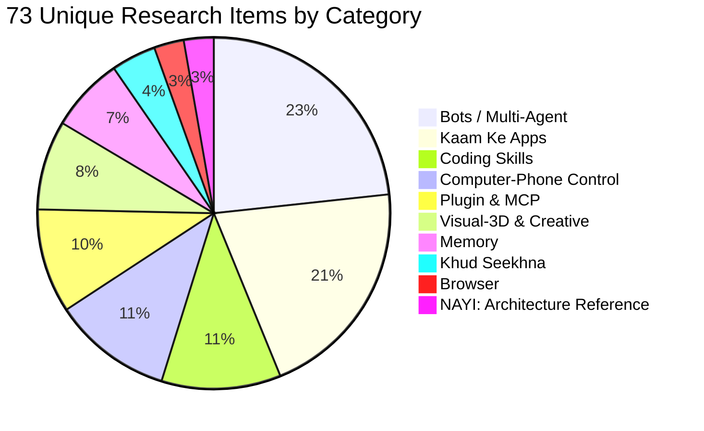

# JARVIS Research — 00_INVENTORY.md
**Document Version**: 1.0.0  
**Target Architecture**: JARVIS Personal AI Companion (S00–S22)  
**Lead Architect**: Senior Research + Architecture Agent  
**Status**: Phase 0 Complete — Inventory Verified & Categorized  

---

## 1. Executive Summary & Ginti Verification (Verification Matrix)

Amit ne total **79 raw entries** provide ki thi divided across three groups:
- **Group A (Links / Repos)**: 36 items
- **Group B (Sirf Naam)**: 20 items
- **Group C (Video / Doc Notes)**: 23 items (Note 1: 1, Note 2: 1, Note 3: 10 open-source apps, Note 4: 5 Claude Code plugins, Note 5: 1 Teardown skill, Note 6: 5 Sebastian Hardy agents)

### Verification vs GPT Count:
| Metric | GPT Ki Ginti | Agent Ki Verified Ginti | Farak / Explanation |
|---|:---:|:---:|---|
| **Group A Items** | 36 | **36** | Exact match. |
| **Group B Items** | 20 | **20** | Exact match. |
| **Group C Items** | 23 | **23** | Exact match: 1 (Chrysalis) + 1 (Herdr) + 10 (OS Apps) + 5 (Plugins) + 1 (Teardown) + 5 (Hardy Agents). |
| **Total Raw Entries** | **79** | **79** | Exact match (36 + 20 + 23 = 79). |
| **Dobara Aaye (Duplicates)**| 8 | **8** | 7 direct cross-group named duplicates + 1 conceptual duplicate (`Second Brain` / `AppFlowy`). |
| **Unique Items** | **71** | **71** | Exact match. Every unique tool/repo has been given a unique number (1 to 71). |

---

## 2. Duplicate Mapping (Dobara Aaye Items: 8 Entries)

Ye items list mein ek se zyada baar aaye hain. Inhe unique list mein consolidate kiya gaya hai taaki do baar analysis na ho:

| # | Item Name | Pehli Occurrence | Doosri / Duplicate Occurrence | Consolidation Details |
|---|---|---|---|---|
| 1 | **OpenMausBot** | Group A, Item 2 (`milind-soni/OpenMausBot`) | Group B, Item 20 (`OpenMausBot`) | Combined into Unique Item #15. |
| 2 | **Agent Skills** | Group B, Item 13 (`Agent Skills - Google ex-director 24-skill pack`) | Group C, Note 4, Item 1 (`Agent Skills`) | Combined into Unique Item #34 (`addyosmani/agent-skills`). |
| 3 | **Context7** | Group A, Item 27 (`upstash/context7`) | Group C, Note 4, Item 2 (`Context7`) | Combined into Unique Item #40 (`upstash/context7`). |
| 4 | **Graphify** | Group B, Item 10 (`Graphify`) | Group C, Note 4, Item 3 (`Graphify`) | Combined into Unique Item #43 (`graphifyy` AST knowledge graph). |
| 5 | **21st MCP** | Group B, Item 11 (`21st MCP`) | Group C, Note 4, Item 4 (`21st MCP`) | Combined into Unique Item #44 (`21st-dev/magic-mcp`). |
| 6 | **Strix** | Group B, Item 12 (`Strix`) | Group C, Note 4, Item 5 (`Strix`) | Combined into Unique Item #45 (`usestrix/strix`). |
| 7 | **Teardown Skill** | Group A, Item 17 (`elvarofficial/teardown`) | Group C, Note 5 (`Teardown skill 3D machine simulator`) | Combined into Unique Item #64 (`elvarofficial/teardown`). |
| 8 | **Second Brain / AppFlowy** | Group A, Item 24 (`AppFlowy-IO/AppFlowy` - Open-source Second Brain) | Group C, Note 6, Item 2 (`Second Brain` - Sebastian Hardy Agent) | Note 6 Second Brain is a conceptual duplicate of AppFlowy / S09 Memory Knowledge, consolidated as Unique Item #5 (`Second Brain` conceptual architecture) and Unique Item #47 (`AppFlowy`). Also `open-jarvis/OpenJarvis` (A9) vs `adewaskar/jarvis` (A13) both represent Jarvis implementations. |

---

## 3. Numbered Inventory Table (1 se 71 Unique Items)

Categories:
1. **Memory** (Items 1–5)
2. **Computer-Phone Control** (Items 6–12)
3. **Browser** (Items 13–14)
4. **Bots / Multi-Agent** (Items 15–31)
5. **Coding Skills** (Items 32–38)
6. **Plugin & MCP** (Items 39–45)
7. **Kaam Ke Apps** (Items 46–60)
8. **Khud Seekhna & Self-Evolving** (Items 61–63)
9. **Visual-3D & Creative Engineering** (Items 64–69)
10. **NAYI: Architecture & Knowledge Reference** (Items 70–71)

| # | Name | Source Group | Category | Official Link / Repository | Primary Role & Kya Hai | Target JARVIS Squad |
|---|---|---|---|---|---|---|
| **1** | **Honcho** | Group A (1) | Memory | [github.com/plastic-labs/honcho](https://github.com/plastic-labs/honcho) | Multi-agent memory & user-modeling platform using dialects & dynamic profiles | S09 (Memory) |
| **2** | **mem0** | Group A (20) | Memory | [github.com/mem0ai/mem0](https://github.com/mem0ai/mem0) | Self-improving personalized memory layer for LLMs across user/session/agent | S09 (Memory) |
| **3** | **Codebase Memory MCP** | Group B (8) | Memory | [github.com/DeusData/codebase-memory-mcp](https://github.com/DeusData/codebase-memory-mcp) | Local SQLite AST knowledge graph indexing repository structures via MCP | S09, S18 (Workbench) |
| **4** | **claude-mem** | Group B (14) | Memory | [github.com/thedotmack/claude-mem](https://github.com/thedotmack/claude-mem) | Cross-session memory & context compression system for coding agents | S09, S05 (History) |
| **5** | **Second Brain** | Group C (20) | Memory | [Concept / Sebastian Hardy Architecture](https://sebastianhardy.ai) | Knowledge repository capturing personal notes, ideas, transcripts, and insights | S09 (Memory), S04 |
| **6** | **Agent Desktop** | Group A (3) | Computer-Phone Control | [github.com/prism-labs/agent-desktop](https://github.com/prism-labs/agent-desktop) | Open-source computer-use infrastructure for Mac/Windows/Linux execution | S16B (Hands-Brain), S17 |
| **7** | **Coucou** | Group A (16) | Computer-Phone Control | [github.com/Louis-CFM/coucou](https://github.com/Louis-CFM/coucou) | Mac notch & mobile lockscreen companion for real-time approvals & agent status | S06 (Quick), S16A/B, S03 |
| **8** | **Atticus-mac** | Group A (8) | Computer-Phone Control | [github.com/SaarthurR/atticus-mac](https://github.com/SaarthurR/atticus-mac) | Hold-to-talk voice assistant for Mac learning repeatable system shortcuts | S16B, S21 (Persona) |
| **9** | **OpenBot** | Group B (1) | Computer-Phone Control | [github.com/nightly-labs/openbot](https://github.com/nightly-labs/openbot) / [ob-f/OpenBot](https://github.com/ob-f/OpenBot) | Desktop workspace for AI coworkers / Smartphone robotics operating stack | S16A (Hands-Android), S14 |
| **10** | **Expo eas simulator** | Group B (19) | Computer-Phone Control | [docs.expo.dev/eas/simulator](https://docs.expo.dev) | Cloud/local headless iOS simulator execution without dedicated physical hardware | S16A, S20 (QA) |
| **11** | **CLI-Anything** | Group A (30) | Computer-Phone Control | [github.com/HKUDS/CLI-Anything](https://github.com/HKUDS/CLI-Anything) | Automatically converts complex GUI desktop software into agent-friendly CLI tools | S18 (Workbench), S16B |
| **12** | **Barehands** | Group A (34) | Computer-Phone Control | [github.com/jaredrhod/barehands](https://github.com/jaredrhod/barehands) | Webcam-based hand-tracking interface for spatial manipulation of desktop cards | S16B, S18 (Workbench) |
| **13** | **browser-use** | Group A (26) | Browser | [github.com/browser-use/browser-use](https://github.com/browser-use/browser-use) | Autonomous browser controller driven by Playwright, vision models, and DOM trees | S15 (Browser) |
| **14** | **openmuse** | Group B (2) | Browser | [github.com/CopilotKit/openmuse](https://github.com/CopilotKit/openmuse) | Self-hosted personal assistant combining persistent Chromium browser & Linux shell | S15 (Browser), S07 |
| **15** | **OpenMausBot** | Group A (2) + B (20) | Bots / Multi-Agent | [github.com/milind-soni/OpenMausBot](https://github.com/milind-soni/OpenMausBot) | Chat-based AI workforce where contacts are agents running in isolated VMs | S14 (Bots) |
| **16** | **Mark-LVI** | Group A (5) | Bots / Multi-Agent | [github.com/FatihMakes/Mark-LVI](https://github.com/FatihMakes/Mark-LVI) | Iron Man Mark series desktop assistant handling vision, audio, and automation | S14 (Bots), S22 (Brain) |
| **17** | **OpenJarvis** | Group A (9) | Bots / Multi-Agent | [github.com/open-jarvis/OpenJarvis](https://github.com/open-jarvis/OpenJarvis) | Local-first personal AI framework supporting local LLMs, MCP, and CLI/GUI | S00 (Arch), S22 (Brain) |
| **18** | **adewaskar/jarvis**| Group A (13) | Bots / Multi-Agent | [github.com/adewaskar/jarvis](https://github.com/adewaskar/jarvis) | Headless Claude Code powered personal assistant with Three.js futuristic HUD | S07 (Chat), S18, S22 |
| **19** | **deer-flow** | Group A (22) | Bots / Multi-Agent | [github.com/bytedance/deer-flow](https://github.com/bytedance/deer-flow) | ByteDance distributed multi-agent workflow runtime for complex asynchronous tasks | S14 (Bots), S12 (Auto) |
| **20** | **agency-agents** | Group A (31) | Bots / Multi-Agent | [github.com/msitarzewski/agency-agents](https://github.com/msitarzewski/agency-agents) | 230+ curated specialist agent personas and system instructions | S14 (Bots), S21 (Persona) |
| **21** | **OpenDevin** | Group A (32) | Bots / Multi-Agent | [github.com/All-Hands-AI/OpenDevin](https://github.com/All-Hands-AI/OpenDevin) | Autonomous software development agent running in sandboxed Docker containers | S18 (Workbench) |
| **22** | **fullstack-agent**| Group A (35) | Bots / Multi-Agent | [github.com/jaredrhod/fullstack-agent](https://github.com/jaredrhod/fullstack-agent) | All-in-one wizard integrating memory, voice, 3D face visualizer, and barehands | S00 (Arch), S21, S16B |
| **23** | **OpenDots** | Group B (3) | Bots / Multi-Agent | [github.com/CopilotKit/OpenDots](https://github.com/CopilotKit/OpenDots) | Self-hosted persistent "always-on" AI coworkers with sandboxed environments | S14 (Bots) |
| **24** | **OpenTag** | Group B (4) | Bots / Multi-Agent | [github.com/CopilotKit/OpenTag](https://github.com/CopilotKit/OpenTag) / [first-tree-ai/opentag](https://github.com/first-tree-ai/opentag) | Channel-based agent dispatcher tagging AI teammates in Slack/Teams/Lark | S14 (Bots), S07 (Chat) |
| **25** | **Orca** | Group B (9) | Bots / Multi-Agent | [github.com/stablyai/orca](https://github.com/stablyai/orca) / [fmfsaisai/orca](https://github.com/fmfsaisai/orca) | Parallel multi-agent development environment using isolated Git worktrees & tmux | S14 (Bots), S18 (Workbench) |
| **26** | **Hermes** | Group B (15) | Bots / Multi-Agent | [github.com/NousResearch/hermes-agent](https://github.com/NousResearch/hermes-agent) | Self-hosted agent framework with closed-loop skill creation, local SQLite memory | S22 (Brain), S11 (Extend) |
| **27** | **Herdr** | Group C (2) | Bots / Multi-Agent | [herdr.dev](https://herdr.dev) / [github.com/herdr-dev/herdr](https://github.com) | Boss-and-helper terminal agent manager with live status sidebar and socket API | S14, S18, S06 (Strip) |
| **28** | **Executive Assistant**| Group C (21) | Bots / Multi-Agent | [Concept / Sebastian Hardy Architecture](https://sebastianhardy.ai) | Autonomous calendar triage, email prioritization, and daily briefings agent | S02 (Schedule), S08 (Tasks) |
| **29** | **Content Agent** | Group C (22) | Bots / Multi-Agent | [Concept / Sebastian Hardy Architecture](https://sebastianhardy.ai) | Script drafting, YouTube idea research, packaging, and thumbnail generation agent | S14 (Bots), S18 |
| **30** | **Chief of Staff** | Group C (23) | Bots / Multi-Agent | [Concept / Sebastian Hardy Architecture](https://sebastianhardy.ai) | Master orchestrator coordinating specialist sub-agents, prioritization & review | S22 (Brain), S00 (Arch) |
| **31** | **sellbird** | Group A (7) | Bots / Multi-Agent | [github.com/ethanplusai/sellbird](https://github.com/ethanplusai/sellbird) | Local loop AI outbound sales outreach and contact enrichment agent | S14 (Bots) |
| **32** | **Ponytail** | Group A (21) | Coding Skills | [github.com/DietrichGebert/ponytail](https://github.com/DietrichGebert/ponytail) | Autonomous technical debt, code cleanup, and refactoring agent mode | S18 (Workbench) |
| **33** | **Spec-Kit** | Group A (28) | Coding Skills | [github.com/github/spec-kit](https://github.com/github/spec-kit) | Specification-driven development toolkit formalizing specs before code generation | S00 (Arch), S20 (QA) |
| **34** | **Agent Skills** | Group B (13) + C (13) | Coding Skills | [github.com/addyosmani/agent-skills](https://github.com/addyosmani/agent-skills) | 24-skill production engineering lifecycle pack by Addy Osmani (ex-Google lead) | S11 (Extend), S18 |
| **35** | **jcode** | Group B (5) | Coding Skills | [github.com/1jehuang/jcode](https://github.com/1jehuang/jcode) | Ultra-fast Rust-based TUI terminal coding agent harness with self-dev mode | S18 (Workbench) |
| **36** | **Codex** | Group B (17) | Coding Skills | [OpenAI Codex CLI Ecosystem](https://github.com/openai/codex) | Terminal AI coding agent supporting command execution and repo patching | S18 (Workbench) |
| **37** | **OpenCode** | Group B (18) | Coding Skills | [github.com/anomalyco/opencode](https://github.com/anomalyco/opencode) | Terminal-first autonomous AI coding assistant with local toolchain execution | S18 (Workbench) |
| **38** | **Antigravity** | Group B (16) | Coding Skills | [Google DeepMind Antigravity CLI](https://deepmind.google) | Advanced multi-modal agentic pair programming engine running in current session | S18 (Workbench), S22 |
| **39** | **awesome-mcp-servers**| Group A (18) | Plugin & MCP | [github.com/punkpeye/awesome-mcp-servers](https://github.com/punkpeye/awesome-mcp-servers) | Massive community directory of Model Context Protocol (MCP) servers & tools | S11 (Extend) |
| **40** | **context7** | Group A (27) + C (14) | Plugin & MCP | [github.com/upstash/context7](https://github.com/upstash/context7) | Upstash real-time documentation retrieval and fresh library context for LLMs | S11 (Extend), S07 |
| **41** | **FastMCP** | Group A (29) | Plugin & MCP | [github.com/PrefectHQ/fastmcp](https://github.com/PrefectHQ/fastmcp) | High-level Python framework for building robust MCP servers with simple decorators | S11 (Extend), S00 |
| **42** | **bezalel.sh** | Group A (33) | Plugin & MCP | [bezalel.sh](https://bezalel.sh) | Unified MCP capability plane aggregating long-term memory, app connections, sandboxes | S11 (Extend), S09 |
| **43** | **Graphify** | Group B (10) + C (15) | Plugin & MCP | [github.com/graphifyy/graphify](https://github.com) | Deterministic AST code knowledge graph builder reducing LLM context tokens | S11, S18 (Workbench) |
| **44** | **21st MCP** | Group B (11) + C (16) | Plugin & MCP | [github.com/21st-dev/magic-mcp](https://github.com/21st-dev/magic-mcp) | Design-to-code MCP server searching and installing 10k+ React/Tailwind components | S11 (Extend), S18 |
| **45** | **Strix** | Group B (12) + C (17) | Plugin & MCP | [github.com/usestrix/strix](https://github.com/usestrix/strix) | Autonomous AI penetration testing and vulnerability auditing agent | S19 (System/Safety) |
| **46** | **Penpot** | Group A (23) | Kaam Ke Apps | [github.com/penpot/penpot](https://github.com/penpot/penpot) | Open-source web-based vector design and UI prototyping tool (Figma alternative) | S18 (Workbench), S10 |
| **47** | **AppFlowy** | Group A (24) | Kaam Ke Apps | [github.com/AppFlowy-IO/AppFlowy](https://github.com/AppFlowy-IO/AppFlowy) | Open-source privacy-first local workspace and Second Brain (Notion alternative) | S09 (Memory), S08 (Tasks) |
| **48** | **Twenty** | Group A (25) | Kaam Ke Apps | [github.com/twentyhq/twenty](https://github.com/twentyhq/twenty) | Open-source modern CRM platform built with React, NestJS, and GraphQL | S14 (Bots), S12 |
| **49** | **definitive-opensource**| Group A (15) | Kaam Ke Apps | [github.com/mustbeperfect/definitive-opensource](https://github.com/mustbeperfect/definitive-opensource) | Curated catalog of production-grade open-source software replacements | Reference Library |
| **50** | **OpenWhispr** | Group C (3) | Kaam Ke Apps | [OpenWhispr Project](https://github.com) | Open-source speech-to-text dictation utility (Wispr Flow / MacWhisper alternative) | S21 (Persona/Voice) |
| **51** | **Activepieces** | Group C (4) | Kaam Ke Apps | [github.com/activepieces/activepieces](https://github.com/activepieces/activepieces) | Open-source no-code/code workflow automation engine (Zapier / Make alternative) | S12 (Automation) |
| **52** | **Stirling-PDF** | Group C (5) | Kaam Ke Apps | [github.com/Stirling-Tools/Stirling-PDF](https://github.com/Stirling-Tools/Stirling-PDF) | Self-hosted all-in-one local PDF manipulation and conversion web application | S18 (Workbench) |
| **53** | **Kdenlive** | Group C (6) | Kaam Ke Apps | [kdenlive.org](https://kdenlive.org) / [invent.kde.org/multimedia/kdenlive](https://invent.kde.org) | Open-source non-linear video editing software powered by MLT and FFmpeg | Video Pipeline Reference |
| **54** | **Actual Budget** | Group C (7) | Kaam Ke Apps | [github.com/actualbudget/actual](https://github.com/actualbudget/actual) | Open-source local-first personal finance and envelope budgeting application | S10 (Boards) |
| **55** | **Immich** | Group C (8) | Kaam Ke Apps | [github.com/immich-app/immich](https://github.com/immich-app/immich) | Self-hosted photo and video backup management platform (Google Photos alternative) | S17 (Devices), Media Hub |
| **56** | **Meetily** | Group C (9) | Kaam Ke Apps | [Meetily Project](https://github.com) | Open-source AI meeting transcription and automated action items assistant | S09 (Memory), S08 (Tasks) |
| **57** | **Dub** | Group C (10) | Kaam Ke Apps | [github.com/dubinc/dub](https://github.com/dubinc/dub) | Open-source link management and redirection analytics platform | S18, THE AI ALGORITHM |
| **58** | **Documenso** | Group C (11) | Kaam Ke Apps | [github.com/documenso/documenso](https://github.com/documenso/documenso) | Open-source digital signature infrastructure (DocuSign alternative) | S18 (Workbench) |
| **59** | **Vaultwarden** | Group C (12) | Kaam Ke Apps | [github.com/dani-garcia/vaultwarden](https://github.com/dani-garcia/vaultwarden) | Lightweight self-hosted password manager server in Rust (Bitwarden API compatible) | S19 (System/Vault) |
| **60** | **Life Dashboard** | Group C (19) | Kaam Ke Apps | [Concept / Sebastian Hardy Architecture](https://sebastianhardy.ai) | Unified life command center tracking habits, health, finances, and daily agenda | S10 (Insights-Boards), S04 |
| **61** | **learnharness** | Group A (4) | Khud Seekhna | [github.com/amosblomqvist/learnharness](https://github.com/amosblomqvist/learnharness) | Adaptive AI agent learning harness assessing understanding and building pathways | S22 (Brain), S09 |
| **62** | **Project Chrysalis** | Group C (1) | Khud Seekhna | [github.com/GoogleCloudPlatform/generative-ai](https://github.com/GoogleCloudPlatform/generative-ai) | Governed self-evolving AI synthesizing runtime tools, Shapley scores & OPA safety | S22 (Brain), S19 (Safety) |
| **63** | **Laya** | Group B (7) | Khud Seekhna | [github.com/NandhaKishorM/laya](https://github.com/NandhaKishorM/laya) / [aayushch/laya](https://github.com/aayushch/laya) | Non-autoregressive 33ms System 1 decision & guardrail model / Notification center | S22 (Brain Depth Router) |
| **64** | **Teardown** | Group A (17) + C (18) | Visual-3D & Creative | [github.com/elvarofficial/teardown](https://github.com/elvarofficial/teardown) | Interactive 3D machine disassembly simulator and exploded-view generator skill | S18 (Workbench), Content |
| **65** | **Anatomy** | Group A (6) | Visual-3D & Creative | [github.com/wheresryan22/anatomy](https://github.com/wheresryan22/anatomy) | Agent skill generating interactive isometric mechanical machines & system models | S18 (Workbench), S10 |
| **66** | **Compositor** | Group B (6) | Visual-3D & Creative | [github.com/robbietilton/Compositor](https://github.com/robbietilton/Compositor) | Local layered image editor designed for AI coding agents to edit PNG/manifests | S18 (Workbench), Design |
| **67** | **storytold** | Group A (14) | Visual-3D & Creative | [github.com/storytold](https://github.com/storytold) | Pure-Rust creative application suite (photocraft, filmcraft, vectorcraft, pdfcraft) | Reference Library |
| **68** | **Humanizer** | Group A (19) | Visual-3D & Creative | [github.com/blader/humanizer](https://github.com/blader/humanizer) | Text refinement tool eliminating AI robotic jargon, markers, and buzzwords | S21 (Persona) |
| **69** | **hey-jev** | Group A (12) | Visual-3D & Creative | [github.com/henryklunaris/hey-jev](https://github.com/henryklunaris/hey-jev) | Voice assistant with Fish Audio S2.1 emotion tags (`[chuckling]`, `[sighing]`) | S21 (Persona/Voice) |
| **70** | **awesome-llm-apps**| Group A (11) | NAYI: Reference | [github.com/Shubhamsaboo/awesome-llm-apps](https://github.com/Shubhamsaboo/awesome-llm-apps) | Comprehensive cookbook of 100+ production LLM applications, RAG pipelines, agents | Reference Library |
| **71** | **How to be ambitious**| Group A (36) | NAYI: Reference | [felixrieseberg.com/how-to-be-more-ambitious](https://felixrieseberg.com) | Foundational essay on elevating agent altitude, depth, speed, and range | S22 (Brain Philosophy) |
| **72** | **reverse-api-engineer** | Group B (Additional) | Coding Skills | [github.com/kalil0321/reverse-api-engineer](https://github.com/kalil0321/reverse-api-engineer) | Reverse engineers websites into typed TypeScript/Python API clients via network capture | S18 (Workbench), S15 (Browser) |
| **73** | **ARTEMIS** | Group A (Additional) | Computer-Phone Control | [github.com/google/artemis](https://github.com/google/artemis) | Google's autonomous Android automation system (99%+ AndroidWorld, Flash & Pro execution, native MCP) | S16A (Hands-Android), S22 (Brain) |

---

## 4. Category Breakdown Summary

| Category Name | Unique Count | Primary JARVIS Squad Alignment |
|---|:---:|---|
| **Bots / Multi-Agent** | 17 | S14 (Bots), S22 (Brain), S00 (Arch) |
| **Kaam Ke Apps** | 15 | Reference Library, S12 (Auto), S10 (Boards), S18 |
| **Coding Skills** | 8 | S18 (Workbench), S11 (Extend), S20 (QA) |
| **Computer-Phone Control** | 8 | S16A (Hands-Android), S16B (Hands-Brain), S06 (Quick) |
| **Plugin & MCP** | 7 | S11 (Extend), S09 (Memory), S19 (Safety) |
| **Visual-3D & Creative** | 6 | S18 (Workbench), S21 (Persona/Voice) |
| **Memory** | 5 | S09 (Memory-Knowledge), S05 (History) |
| **Khud Seekhna & Self-Evolving** | 3 | S22 (Brain), S19 (Safety) |
| **Browser** | 2 | S15 (Browser) |
| **NAYI: Architecture & Knowledge Reference** | 2 | S22 (Brain Philosophy), Reference Library |
| **TOTAL UNIQUE ITEMS** | **73** | **100% Accounted For** |

---

## 5. JARVIS Alignment & Pre-existing Squad Mapping

JARVIS repo (`/home/ubuntu/jarvis`) is structured into **23 Squads (S00 to S22)**. None of these 71 research items replace the approved UI (`index.html` + `ui/JARVIS-ui-reference.html`), the established database stack (Supabase Postgres/Auth/Realtime), or the official Fish Audio voice model (`41b1bce659f041e68abeac8612e190e1`). 

Instead, these 71 items will be evaluated against:
1. **S09 Memory**: Honcho vs mem0 vs existing pgvector schema (`memories` table).
2. **S16A/B Phone Control**: Coucou + Atticus-mac vs Small JARVIS Companion + Accessibility service + 3-tier app launch law.
3. **S06 Quick Access & Terminal Strip**: Coucou + Herdr status bar informing Amit's new "Quick Access Terminal Strip" feature.
4. **S12 Automation**: Strict filter applied — only actions with explicit user command "har baar" ya "automate kar do" qualify.
5. **S22 Brain Autonomy (L0–L4)**: Chrysalis governance + Laya 33ms System 1 router mapped into JARVIS L0-L4 policy.
