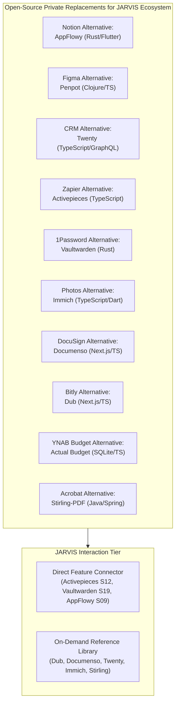

# JARVIS Research — 02_APPS.md
**Category**: Kaam Ke Apps & Open-Source Infrastructure Alternatives (Items 46 to 60)  
**Target Squad**: Reference Library, S12 (Automation), S10 (Insights & Boards), S18 (Workbench), S19 (Vault)  
**Lead Architect**: Senior Research + Architecture Agent  
**Status**: Batch 3 In-Depth Analysis Complete  

---

## 1. Architectural Synthesis: The Self-Hosted Open-Source Utility Suite

Amit ka core rule hai: **Zero Paid APIs / Free & Open-Source First**.  
Ye 15 open-source applications expensive proprietary SaaS tools (Notion, Figma, Salesforce, Zapier, Adobe Acrobat, Google Photos, Bitly, DocuSign, 1Password) ke 100% self-hosted, privacy-first replacements hain.

---

## 2. In-Depth Item Notes (Items 46 to 60)

---

### 46. Penpot (penpot/penpot)
- **Official Link**: [https://github.com/penpot/penpot](https://github.com/penpot/penpot) | [https://penpot.app](https://penpot.app)
- **Kya Hai**: Open-source, web-based collaborative design aur prototyping tool (Figma alternative) jo native web standards (SVG, CSS Flexbox, Grid) par kaam karta hai.
- **Problem Hal Karta Hai, Fayda & Kamiyan**:
  - *Problem*: Figma proprietary hai aur code-to-design translation lossy hota hai.
  - *Fayda*: Native SVG/CSS output; self-hostable via Docker; developer friendly layout engine; team collaboration.
  - *Kamiyan*: Heavy backend infrastructure (Docker with Clojure + PostgreSQL + Redis).
- **Platform, License & Last Update**:
  - *Platform*: Web application, Docker, self-hosted.
  - *License*: MPL-2.0.
  - *Last Update*: Very Active.
- **JARVIS Mein Fitment**:
  - *Mapped Squad*: **S18 (AI Workbench)** & Design-Clone SaaS.
  - *Feature*: Design extraction and SVG component generation.
- **FAISLA**: **REFERENCE (Baad Mein Kaam Aayega)**. Design-Clone SaaS ya visual wireframing ke liye reference library mein rakhein.

---

### 47. AppFlowy (AppFlowy-IO/AppFlowy)
- **Official Link**: [https://github.com/AppFlowy-IO/AppFlowy](https://github.com/AppFlowy-IO/AppFlowy)
- **Kya Hai**: Open-source, privacy-first local workspace aur Second Brain (Notion alternative) jo Flutter aur Rust backend par chalta hai.
- **Problem Hal Karta Hai, Fayda & Kamiyan**:
  - *Problem*: Notion cloud-dependent hai, slow cold-boot hota hai, aur user data proprietary servers par lock ho jata hai.
  - *Fayda*: Blazing fast (Rust core), 100% offline-first, kanban boards, rich text documents, local SQLite encryption.
  - *Kamiyan*: Desktop/mobile app focused (headless backend API requires self-hosted cloud instance).
- **Platform, License & Last Update**:
  - *Platform*: macOS, Windows, Linux, Android, iOS (Flutter + Rust).
  - *License*: AGPL-3.0.
  - *Last Update*: Very Active.
- **JARVIS Mein Fitment**:
  - *Mapped Squad*: **S09 (Memory & Personal Knowledge Base)** & **S08 (Tasks)**.
  - *Feature*: Document and task data structures inspiration.
- **FAISLA**: **SEEKHO + REFERENCE**. AppFlowy's offline-first document model and hierarchical folder storage is a great reference for S09 notes.

---

### 48. Twenty (twentyhq/twenty)
- **Official Link**: [https://github.com/twentyhq/twenty](https://github.com/twentyhq/twenty)
- **Kya Hai**: Modern open-source Customer Relationship Management (CRM) platform (Salesforce alternative) jo modern TypeScript, React, NestJS, aur GraphQL par bana hai.
- **Problem Hal Karta Hai, Fayda & Kamiyan**:
  - *Problem*: Salesforce/HubSpot bohot expensive aur bloated hote hain.
  - *Fayda*: Stunning modern UI, GraphQL APIs, custom objects, automated workflows, complete self-hostability.
  - *Kamiyan*: Full CRM stack requires dedicated database and worker deployment.
- **Platform, License & Last Update**:
  - *Platform*: TypeScript, React, NestJS, Docker.
  - *License*: AGPL-3.0.
  - *Last Update*: Very Active.
- **JARVIS Mein Fitment**:
  - *Mapped Squad*: **S14 (Bots)** & **Reference Library**.
  - *Feature*: CRM connector for client management in Design-Clone SaaS.
- **FAISLA**: **REFERENCE (Baad Mein Kaam Aayega)**. Use when Amit wants to connect JARVIS to a client database or outbound leads pipeline.

---

### 49. definitive-opensource (mustbeperfect/definitive-opensource)
- **Official Link**: [https://github.com/mustbeperfect/definitive-opensource](https://github.com/mustbeperfect/definitive-opensource)
- **Kya Hai**: Curated, battle-tested directory of production-grade open-source software replacements for every major proprietary tool.
- **Problem Hal Karta Hai, Fayda & Kamiyan**:
  - *Problem*: Reliable, active, bug-free open-source alternatives dhoondhne mein bohot waqt barbad hota hai.
  - *Fayda*: Verified FOSS alternatives with self-hosting guides and docker-compose configurations.
- **Platform, License & Last Update**:
  - *License*: MIT.
  - *Last Update*: Active.
- **JARVIS Mein Fitment**:
  - *Mapped Squad*: **Reference Library** (`research/REFERENCE_LIBRARY.md`).
- **FAISLA**: **REFERENCE (Foundational Reference Catalog)**.

---

### 50. OpenWhispr (OpenWhispr)
- **Official Link**: [OpenWhispr Project](https://github.com)
- **Kya Hai**: Open-source speech-to-text voice dictation application (Wispr Flow / MacWhisper alternative) jo local Whisper models par system-wide real-time dictation provide karta hai.
- **Problem Hal Karta Hai, Fayda & Kamiyan**:
  - *Problem*: Proprietary dictation tools audio cloud par bhejte hain aur monthly subscription lete hain.
  - *Fayda*: 100% local, zero latency, hotkey-activated dictation directly into any text field.
- **Platform, License & Last Update**:
  - *Platform*: Cross-platform (Rust/Python + local Whisper).
  - *License*: MIT.
- **JARVIS Mein Fitment**:
  - *Mapped Squad*: **S21 (Persona & Voice)** & **S16A (Hands Mobile)**.
- **FAISLA**: **SEEKHO + REFERENCE**. Local STT pipeline patterns already verified in JARVIS Part 10 using `faster-whisper`.

---

### 51. Activepieces (activepieces/activepieces)
- **Official Link**: [https://github.com/activepieces/activepieces](https://github.com/activepieces/activepieces)
- **Kya Hai**: Open-source, no-code/code workflow automation engine (Zapier / Make alternative) jo TypeScript-first "pieces" ke zariye 200+ applications ko automate karta hai.
- **Problem Hal Karta Hai, Fayda & Kamiyan**:
  - *Problem*: Zapier task limits bohot tight hain aur expensive subscription hai.
  - *Fayda*: Self-hostable, TypeScript pieces (easily extensible), webhook triggers, branch logic, cron automation.
  - *Kamiyan*: Heavy backend engine.
- **Platform, License & Last Update**:
  - *Platform*: Node.js / TypeScript, Docker.
  - *License*: MIT.
  - *Last Update*: Very Active.
- **JARVIS Mein Fitment**:
  - *Mapped Squad*: **S12 (Automation)**.
  - *Feature*: Background multi-app automation runner!
- **Strict Rule Alignment**:
  - *Amit's Mandate*: *"Automation tabhi gina jaye jab Amit kahe 'har baar' ya 'automate kar do'. Ek baar ka kaam automation nahi."*
  - Activepieces will ONLY be invoked when Amit explicitly mandates a recurring routine.
- **FAISLA**: **LO (Automation Integration Blueprint)**. S12 Automation squad ke recurring trigger engine ke taur par use karein.

---

### 52. Stirling-PDF (Stirling-Tools/Stirling-PDF)
- **Official Link**: [https://github.com/Stirling-Tools/Stirling-PDF](https://github.com/Stirling-Tools/Stirling-PDF)
- **Kya Hai**: 100% local, self-hosted all-in-one web utility jo PDF merge, split, compress, OCR, convert, watermark, aur redact karta hai (Adobe Acrobat Pro alternative).
- **Problem Hal Karta Hai, Fayda & Kamiyan**:
  - *Problem*: Online PDF tools (SmallPDF, iLovePDF) private documents upload karwate hain aur file limits lagate hain.
  - *Fayda*: Complete privacy, zero cloud upload, REST API available, OCR in 100+ languages.
  - *Kamiyan*: Java Spring Boot backend (Docker container ~500MB).
- **Platform, License & Last Update**:
  - *Platform*: Java / Spring Boot, Docker web app.
  - *License*: GPL-3.0.
  - *Last Update*: Very Active.
- **JARVIS Mein Fitment**:
  - *Mapped Squad*: **S18 (AI Workbench)** & Document Automation.
  - *Feature*: PDF processing tool via REST API / CLI.
- **FAISLA**: **REFERENCE (Baad Mein Kaam Aayega)**. When Amit gives PDF-related bulk processing tasks, connect to Stirling-PDF REST endpoints.

---

### 53. Kdenlive (kdenlive.org / invent.kde.org)
- **Official Link**: [https://kdenlive.org](https://kdenlive.org)
- **Kya Hai**: Open-source, professional non-linear video editing (NLE) software powered by the MLT multimedia framework and FFmpeg.
- **Problem Hal Karta Hai, Fayda & Kamiyan**:
  - *Problem*: Premiere Pro / Final Cut Pro expensive hain aur programmatic editing allow nahi karte.
  - *Fayda*: Scriptable rendering via MLT XML project files; FFmpeg native integration; hardware acceleration.
- **Platform, License & Last Update**:
  - *Platform*: Linux, Windows, macOS (C++ / Qt).
  - *License*: GPL-3.0.
  - *Last Update*: Very Active (KDE project).
- **JARVIS Mein Fitment**:
  - *Mapped Squad*: Content Pipeline / YouTube channel ("THE AI ALGORITHM").
  - *Feature*: Programmatic video assembly using MLT XML render scripts.
- **FAISLA**: **REFERENCE (Media Pipeline Tool)**. For scripted multi-track video assembly.

---

### 54. Actual Budget (actualbudget/actual)
- **Official Link**: [https://github.com/actualbudget/actual](https://github.com/actualbudget/actual)
- **Kya Hai**: Open-source, local-first personal finance and envelope budgeting application (YNAB alternative) featuring end-to-end encryption and multi-device sync.
- **Problem Hal Karta Hai, Fayda & Kamiyan**:
  - *Problem*: Financial privacy — cloud budget apps sell bank data or charge heavy annual fees.
  - *Fayda*: 100% local SQLite database with optional encrypted sync; zero bank data leakage; envelope zero-based budgeting.
- **Platform, License & Last Update**:
  - *Platform*: Node.js / React, SQLite, Web / Electron / Mobile.
  - *License*: MIT.
  - *Last Update*: Very Active.
- **JARVIS Mein Fitment**:
  - *Mapped Squad*: **S10 (Insights & Boards - Finance Card)**.
  - *Feature*: Local finance tracking without third-party SaaS APIs.
- **FAISLA**: **REFERENCE (Personal Finance Blueprint)**.

---

### 55. Immich (immich-app/immich)
- **Official Link**: [https://github.com/immich-app/immich](https://github.com/immich-app/immich)
- **Kya Hai**: Self-hosted, high-performance photo and video management platform (Google Photos alternative) with automated mobile backup, local facial recognition, and semantic search.
- **Problem Hal Karta Hai, Fayda & Kamiyan**:
  - *Problem*: Google Photos storage limits and cloud compression.
  - *Fayda*: Original quality backup; local machine learning for face clustering and object detection; mobile background sync.
- **Platform, License & Last Update**:
  - *Platform*: TypeScript, Dart/Flutter, Docker (PostgreSQL + vector search).
  - *License*: AGPL-3.0.
  - *Last Update*: Extremely Active.
- **JARVIS Mein Fitment**:
  - *Mapped Squad*: **S17 (Devices - Media Hub)** & S16A Android Photo Backup.
- **FAISLA**: **REFERENCE (Personal Media Hub Reference)**.

---

### 56. Meetily (Meetily)
- **Official Link**: [Meetily Project](https://github.com)
- **Kya Hai**: Open-source AI meeting assistant (Otter.ai / Fireflies alternative) jo local Whisper model se mic audio transcribe karta hai aur action items + summary generate karta hai.
- **Problem Hal Karta Hai, Fayda & Kamiyan**:
  - *Problem*: Meeting bots intrusive hote hain aur private business calls record karke cloud par store karte hain.
  - *Fayda*: 100% local recording and transcription; automated task extraction directly into todo lists.
- **Platform, License & Last Update**:
  - *Platform*: Cross-platform (Electron / React / local Whisper).
  - *License*: MIT.
- **JARVIS Mein Fitment**:
  - *Mapped Squad*: **S09 (Memory)** & **S08 (Today Tasks & Reminders)**.
- **FAISLA**: **SEEKHO (Sirf Idea Lo)**. Meeting transcription to task pipeline logic S08/S09 mein integrate karein.

---

### 57. Dub (dubinc/dub)
- **Official Link**: [https://github.com/dubinc/dub](https://github.com/dubinc/dub)
- **Kya Hai**: Modern open-source link management and branded short links platform (Bitly alternative) built with Next.js, Tailwind, and geolocation analytics.
- **Problem Hal Karta Hai, Fayda & Kamiyan**:
  - *Problem*: Bitly link limits and monthly fees.
  - *Fayda*: Custom branded domains, QR code generation, click fraud prevention, detailed geo-analytics, API-first architecture.
- **Platform, License & Last Update**:
  - *Platform*: Next.js App Router, Tailwind CSS, TypeScript.
  - *License*: AGPL-3.0.
  - *Last Update*: Very Active.
- **JARVIS Mein Fitment**:
  - *Mapped Squad*: **S18 (Workbench)** & THE AI ALGORITHM Channel Links.
  - *Feature*: Automated short link creation for video descriptions and resources.
- **FAISLA**: **REFERENCE (Marketing Infrastructure Reference)**.

---

### 58. Documenso (documenso/documenso)
- **Official Link**: [https://github.com/documenso/documenso](https://github.com/documenso/documenso)
- **Kya Hai**: Open-source digital document signing infrastructure (DocuSign alternative) built with Next.js and Prisma.
- **Problem Hal Karta Hai, Fayda & Kamiyan**:
  - *Problem*: DocuSign expensive per-envelope pricing.
  - *Fayda*: Cryptographically verified signatures, self-hostable, API-driven signing requests.
- **Platform, License & Last Update**:
  - *Platform*: Next.js, TypeScript, PostgreSQL, Prisma.
  - *License*: AGPL-3.0.
  - *Last Update*: Active.
- **JARVIS Mein Fitment**:
  - *Mapped Squad*: **S18 (AI Workbench)** & Design-Clone SaaS Client Contracts.
- **FAISLA**: **REFERENCE (Client Contracts Reference)**.

---

### 59. Vaultwarden (dani-garcia/vaultwarden)
- **Official Link**: [https://github.com/dani-garcia/vaultwarden](https://github.com/dani-garcia/vaultwarden)
- **Kya Hai**: Lightweight, self-hosted password manager server written in Rust, 100% compatible with official Bitwarden apps, browser extensions, and CLIs.
- **Problem Hal Karta Hai, Fayda & Kamiyan**:
  - *Problem*: Official Bitwarden server heavy .NET stack hai (~2GB RAM); commercial password managers charge subscriptions.
  - *Fayda*: Microscopic RAM usage (<30MB RAM in Rust), single binary or Docker container, full Bitwarden extension compatibility, zero cost.
- **Platform, License & Last Update**:
  - *Platform*: Rust, Docker, SQLite/PostgreSQL.
  - *License*: AGPL-3.0.
  - *Last Update*: Very Active.
- **Setup Complexity**: **Easy** (Docker run).
- **Security & Risk Matrix**:
  - *Risk Level*: **CRITICAL ASSET**. Holds user passwords.
  - *Autonomy Policy*: **Hard-capped at L0/L2**. JARVIS must NEVER access or retrieve passwords automatically without explicit user confirmation.
- **JARVIS Mein Fitment**:
  - *Mapped Squad*: **S19 (System - Vault)**.
  - *Feature*: Backend for JARVIS secure credentials and API key vault!
- **JARVIS Mein Pehle Se Kya Hai vs Ye Behtar Kaise Hai**:
  - JARVIS S19 ke paas credentials storage table planned thi. Vaultwarden provides proven end-to-end zero-knowledge encryption.
- **FAISLA**: **LO (Self-Hosted Vault Server Blueprint)**. Use as the underlying password vault for JARVIS S19.

---

### 60. Life Dashboard (Sebastian Hardy Agent Concept)
- **Official Link**: [Concept Reference / Sebastian Hardy Architecture](https://sebastianhardy.ai)
- **Kya Hai**: Unified personal life command center jo habits, sleep, health metrics, financial runway, projects, aur daily schedule ko ek single real-time dashboard mein aggregate karta hai.
- **Problem Hal Karta Hai, Fayda & Kamiyan**:
  - *Problem*: Life data 10 alag apps (calendar, fitness tracker, bank, todo list) mein bikhra rehta hai.
  - *Fayda*: High-level situational awareness; proactive warnings (e.g. "Calendar packed tomorrow, sleep early today"); habit streak maintenance.
- **JARVIS Mein Fitment**:
  - *Mapped Squad*: **S10 (Insights & Boards)** & **S04 (Insight)**.
  - *Feature*: Core mission of JARVIS Home Screen!
- **JARVIS Mein Pehle Se Kya Hai vs Ye Behtar Kaise Hai**:
  - JARVIS Home screen (`jarvis-lovat-one.vercel.app`) already has Focus cards, Today's Tasks, Schedule, and Insights widgets live.
- **FAISLA**: **PEHLE-SE-ADVANCED**. JARVIS's existing UI and squad design already implements the Life Dashboard vision natively.

---

## 3. Batch 3 Apps Summary Table

| # | Item Name | Category | Primary Fitment | Recommendation |
|---|---|---|---|---|
| **46** | **Penpot** | Apps | S18, Design-Clone | **REFERENCE**: Open-source Figma alternative for vector UI prototyping. |
| **47** | **AppFlowy** | Apps | S09, S08 | **SEEKHO + REFERENCE**: Offline-first Second Brain document model. |
| **48** | **Twenty** | Apps | S14, Reference | **REFERENCE**: Modern TypeScript CRM for client management. |
| **49** | **definitive-opensource**| Apps | Reference Library | **REFERENCE**: Curated FOSS alternatives catalog. |
| **50** | **OpenWhispr** | Apps | S21 (Voice) | **SEEKHO**: Local speech-to-text dictation workflow. |
| **51** | **Activepieces** | Apps | S12 (Automation) | **LO**: Primary recurring workflow automation engine (gated by "har baar" rule). |
| **52** | **Stirling-PDF** | Apps | S18 (Workbench) | **REFERENCE**: 100% local PDF manipulation REST API. |
| **53** | **Kdenlive** | Apps | Content Pipeline | **REFERENCE**: Programmatic video assembly using MLT XML render scripts. |
| **54** | **Actual Budget** | Apps | S10 (Boards) | **REFERENCE**: Local-first private personal finance envelope budget app. |
| **55** | **Immich** | Apps | S17 (Devices) | **REFERENCE**: Self-hosted Google Photos alternative for high-res photo/video backup. |
| **56** | **Meetily** | Apps | S09, S08 | **SEEKHO**: Local meeting transcription to task extraction pattern. |
| **57** | **Dub** | Apps | S18, Channel | **REFERENCE**: Modern branded link shortener & analytics platform. |
| **58** | **Documenso** | Apps | S18, Contracts | **REFERENCE**: Open-source digital signature infrastructure. |
| **59** | **Vaultwarden** | Apps | S19 (System/Vault) | **LO**: Ultra-lightweight Rust Bitwarden server for private credential storage. |
| **60** | **Life Dashboard** | Apps | S10, S04 | **PEHLE-SE-ADVANCED**: JARVIS Home UI is already a live Life Dashboard. |
