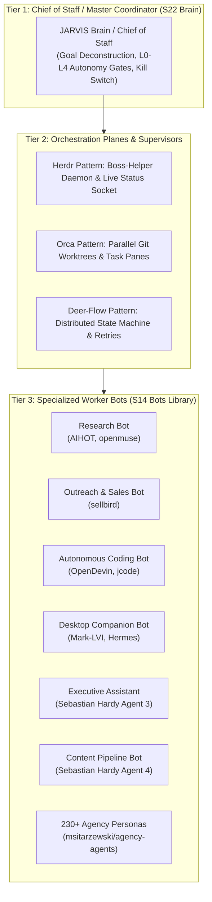

# JARVIS Research — 02_BOTS.md
**Category**: Bots & Multi-Agent Orchestration (Items 15 to 31)  
**Target Squad**: S14 (Bots Workspace), S22 (Brain / Chief of Staff), S18 (AI Workbench), S00 (Architecture)  
**Lead Architect**: Senior Research + Architecture Agent  
**Status**: Batch 1 In-Depth Analysis Complete  

---

## 1. Architectural Synthesis: The Multi-Agent Hierarchy for JARVIS

JARVIS S14 squad ka maqsad hai: *Research, Email, Shopping, Social Media, Search, Coding, Personal Assistant, Custom Bots, aur Multi-Agent Orchestration*.

### Key Multi-Agent Design Rules for JARVIS:
1. **Single Boss Rule**: Amit ke saath baat sirf JARVIS (S21 voice, S07 chat) karega. Baaki saare bots sub-workers ya helpers honge. Direct user interjections nahi honge jab tak L2 confirmation na mangna ho.
2. **Worktree Isolation (Orca pattern)**: Jab do bots parallel coding ya document drafting karein, har bot alag isolated Git worktree ya scratch workspace mein execute karega taaki file collisions na hon.
3. **Live Status Sidebar / Strip (Herdr + Coucou pattern)**: Amit ko Quick Access Terminal Strip par har bot ka state (`idle`, `working`, `blocked`, `done`) ek icon aur percentage mein dikhega.

---

## 2. In-Depth Item Notes (Items 15 to 31)

---

### 15. OpenMausBot (milind-soni/OpenMausBot)
- **Official Link**: [https://github.com/milind-soni/OpenMausBot](https://github.com/milind-soni/OpenMausBot)
- **Kya Hai**: Open-source, local-first desktop application aur AI agent workspace jo messaging contacts ki tarah AI bots ki team banata hai, jahan har bot apni isolated virtual machine mein shell commands aur code chala sakta hai.
- **Problem Hal Karta Hai, Fayda & Kamiyan**:
  - *Problem*: Traditional bots ek hi environment share karte hain jisse files corrupt hone ka risk rehta hai.
  - *Fayda*: Messaging app UI (WhatsApp/Telegram style contacts for bots), isolated VM runtimes, approval gates before shell commands, BYO model keys.
  - *Kamiyan*: Heavy desktop client; local VMs spin up karne par high RAM/disk overhead hota hai.
- **Platform, License & Last Update**:
  - *Platform*: Desktop (macOS, Windows, Linux) + mobile companion.
  - *License*: MIT.
  - *Last Update*: Active.
- **Kaise Kaam Karta Hai**:
  - Contacts list mein multiple agents hote hain (e.g. `@researcher`, `@coder`).
  - Har contact ke peeche ek isolated execution runner hota hai.
- **Setup Complexity**: **Medium**.
- **Security & Risk Matrix**:
  - *Risk Level*: **Medium**. Shell commands are gated by user approval.
- **JARVIS Mein Fitment**:
  - *Mapped Squad*: **S14 (Bots)** & **S07 (Chat)**.
  - *Feature*: JARVIS ke "Add Bot" aur bots contacts list ka UI inspiration.
- **JARVIS Mein Pehle Se Kya Hai vs Ye Behtar Kaise Hai**:
  - JARVIS mein `public.bots` table already planned hai (`kind`, `status`, `config`). OpenMausBot ka contact-centric paradigm JARVIS Bots screen ke layout ke liye fit hai.
- **FAISLA**: **SEEKHO (Sirf Idea Lo)**. Multi-bot chat contact pattern aur isolated sandbox approval workflow ko adopt karein.

---

### 16. Mark-LVI (FatihMakes/Mark-LVI)
- **Official Link**: [https://github.com/FatihMakes/Mark-LVI](https://github.com/FatihMakes/Mark-LVI)
- **Kya Hai**: Iron Man Mark series suit se inspired open-source desktop personal AI assistant jo voice, vision, web automation aur system commands handle karta hai.
- **Problem Hal Karta Hai, Fayda & Kamiyan**:
  - *Problem*: Generic assistant projects boring lagte hain aur Iron Man jaisi proactive companion feel nahi dete.
  - *Fayda*: Stark-inspired aesthetic, voice-first activation, multi-modal vision parsing.
  - *Kamiyan*: Python monolithic architecture; code quality variable hai; production tests missing hain.
- **Platform, License & Last Update**:
  - *Platform*: Python, Windows/Linux/Mac.
  - *License*: MIT.
  - *Last Update*: Active.
- **Security & Risk Matrix**:
  - *Risk Level*: **Medium** (Direct system commands execution).
- **JARVIS Mein Fitment**:
  - *Mapped Squad*: **S21 (Persona)** & **S14 (Bots)**.
- **JARVIS Mein Pehle Se Kya Hai vs Ye Behtar Kaise Hai**:
  - JARVIS architecture (S00–S22, Supabase, TypeScript, strict contracts, Fish Audio) Mark-LVI ke monolithic Python script se **bohot aage hai**.
- **FAISLA**: **PEHLE-SE-ADVANCED**. JARVIS is already significantly more architecturally sound and production-ready.

---

### 17. OpenJarvis (open-jarvis/OpenJarvis)
- **Official Link**: [https://github.com/open-jarvis/OpenJarvis](https://github.com/open-jarvis/OpenJarvis)
- **Kya Hai**: On-device personal AI research framework jo local hardware (Ollama, vLLM, llama.cpp) par multi-step agents, MCP servers, aur local learning loop run karta hai.
- **Problem Hal Karta Hai, Fayda & Kamiyan**:
  - *Problem*: Cloud-dependent AI companions slow aur costly hote hain.
  - *Fayda*: Resource-aware evaluation (FLOPs, latency, energy, dollar cost); local learning from user execution traces; Apache-2.0 license.
  - *Kamiyan*: Complex multi-engine installation; non-technical users ke liye difficult.
- **Platform, License & Last Update**:
  - *Platform*: Python SDK, CLI `jarvis`, cross-platform desktop.
  - *License*: Apache-2.0.
  - *Last Update*: Active.
- **Security & Risk Matrix**:
  - *Safety Warning*: Official install scripts use `curl | bash` (Safety rule 3 says treat as risky data; do not run raw installers).
- **JARVIS Mein Fitment**:
  - *Mapped Squad*: **S00 (Arch)**, **S13 (Prefs/Models)**, **S22 (Brain)**.
- **JARVIS Mein Pehle Se Kya Hai vs Ye Behtar Kaise Hai**:
  - JARVIS web app + Supabase serverless model par chalta hai. OpenJarvis ka local runtime detection (agar device par GPU ho toh local model chalao, warna fallback) JARVIS S13 model gateway ke liye useful hai.
- **FAISLA**: **SEEKHO + REFERENCE**. Local execution trace evaluation and resource-aware routing ideas are valuable for S13/S22.

---

### 18. adewaskar/jarvis (adewaskar/jarvis)
- **Official Link**: [https://github.com/adewaskar/jarvis](https://github.com/adewaskar/jarvis)
- **Kya Hai**: Personal assistant project jo Claude Code ko headless brain ki tarah use karta hai aur React + Three.js GLSL shaders se dynamic futuristic Iron Man face render karta hai.
- **Problem Hal Karta Hai, Fayda & Kamiyan**:
  - *Problem*: AI chat apps dull lagti hain; live visual avatar ya voice feedback nahi hota.
  - *Fayda*: Headless Claude Code integration; futuristic Three.js shader visualizer.
  - *Kamiyan*: Heavy WebGL shader battery consume karta hai; phone control is basic ADB wrapper.
- **Platform, License & Last Update**:
  - *Platform*: React, Vite, Node.js, Python.
  - *License*: MIT.
  - *Last Update*: Active.
- **JARVIS Mein Fitment**:
  - *Mapped Squad*: **S07 (Chat)**, **S18 (Workbench)**.
- **JARVIS Mein Pehle Se Kya Hai vs Ye Behtar Kaise Hai**:
  - JARVIS ka UI already final aur approved hai (`jarvis-lovat-one.vercel.app`), isliye iska Three.js face JARVIS mein add nahi hoga. Lekin headless agent execution pattern S18 AI Workbench mein applicable hai.
- **FAISLA**: **SEEKHO (Sirf Idea Lo)**. Headless agent calling pattern S18 ke liye use karo.

---

### 19. deer-flow (bytedance/deer-flow)
- **Official Link**: [https://github.com/bytedance/deer-flow](https://github.com/bytedance/deer-flow)
- **Kya Hai**: ByteDance ka open-source distributed multi-agent workflow framework jo complex, long-running asynchronous tasks ko state machine aur resilient retry logic ke saath orchestrate karta hai.
- **Problem Hal Karta Hai, Fayda & Kamiyan**:
  - *Problem*: Jab multi-agent workflows 10+ steps tak chalte hain, toh beech mein ek model call fail hone par poora task drop ho jata hai.
  - *Fayda*: Enterprise-grade state machine, state snapshotting, checkpointing, distributed task queues, automatic retry and branch switching.
  - *Kamiyan*: Enterprise scale ke liye designed hai; single-user personal companion ke liye thoda over-engineered hai.
- **Platform, License & Last Update**:
  - *Platform*: Python / Go distributed runtime.
  - *License*: Apache-2.0.
  - *Last Update*: Active.
- **Setup Complexity**: **Hard**.
- **JARVIS Mein Fitment**:
  - *Mapped Squad*: **S14 (Bots)** & **S12 (Automation)**.
  - *Feature*: Resilient multi-step bot execution engine.
- **JARVIS Mein Pehle Se Kya Hai vs Ye Behtar Kaise Hai**:
  - JARVIS mein `worker/jobs` simple database-driven cron jobs run karta hai. Deer-Flow ka step-checkpointing pattern (agar step 4 fail ho toh step 1-3 dobara na chalein) JARVIS worker ke liye gold standard hai.
- **FAISLA**: **SEEKHO (State Machine & Checkpointing Idea Lo)**.

---

### 20. agency-agents (msitarzewski/agency-agents)
- **Official Link**: [https://github.com/msitarzewski/agency-agents](https://github.com/msitarzewski/agency-agents)
- **Kya Hai**: 230+ production-tested specialist AI agent system prompts, persona briefs, aur operational instructions ka curated repository (Finance, Marketing, Coding, HR, Legal, Creative).
- **Problem Hal Karta Hai, Fayda & Kamiyan**:
  - *Problem*: Har naye bot ke liye scratch se system prompt aur boundary rules likhne padte hain.
  - *Fayda*: 230+ ready-to-deploy specialist personas with deep domain-specific vocabulary, anti-hallucination guardrails, and role expectations.
  - *Kamiyan*: Pure text prompts (code ya runtime nahi hai).
- **Platform, License & Last Update**:
  - *Platform*: Markdown prompts / System prompts.
  - *License*: MIT.
  - *Last Update*: Constantly updated.
- **Setup Complexity**: **Instant** (Copy-paste ready).
- **Security & Risk Matrix**:
  - *Risk Level*: **Zero / Safe**. Pure text data.
- **JARVIS Mein Fitment**:
  - *Mapped Squad*: **S14 (Bots - Bot Templates & Presets)** & **S21 (Persona)**.
  - *Feature*: JARVIS Bots Workspace ke "Add Bot from Template" feature ka master library!
- **JARVIS Mein Pehle Se Kya Hai vs Ye Behtar Kaise Hai**:
  - JARVIS ke paas bots table thi par actual persona prompt catalog empty tha. Ye seedha 230+ templates provide karta hai.
- **FAISLA**: **REFERENCE (Baad Mein Kaam Aayega - Master Bot Template Library)**. `research/REFERENCE_LIBRARY.md` mein include karein taaki Amit jab bhi koi naya bot maange, instantly load ho sake.

---

### 21. OpenDevin (All-Hands-AI/OpenDevin / OpenHands)
- **Official Link**: [https://github.com/All-Hands-AI/OpenDevin](https://github.com/All-Hands-AI/OpenDevin)
- **Kya Hai**: Autonomous software development agent jo browser, terminal aur code editor ko sandboxed Docker container mein chala kar complex GitHub issues aur software features implement karta hai.
- **Problem Hal Karta Hai, Fayda & Kamiyan**:
  - *Problem*: Simple LLM chat code snippets deta hai jinko manually paste aur test karna padta hai.
  - *Fayda*: Full autonomous development loop (clone repo, write code, run unit tests, fix errors, open PR); secure sandboxed Docker execution.
  - *Kamiyan*: Heavy Docker footprint; high token usage for continuous self-repair loops.
- **Platform, License & Last Update**:
  - *Platform*: Python, Docker, React.
  - *License*: MIT.
  - *Last Update*: Very Active.
- **Security & Risk Matrix**:
  - *Risk Level*: **Medium**. Executes arbitrary code inside Docker container.
- **JARVIS Mein Fitment**:
  - *Mapped Squad*: **S18 (AI Workbench)**.
  - *Feature*: JARVIS ke AI Workbench ka coding automation mode.
- **JARVIS Mein Pehle Se Kya Hai vs Ye Behtar Kaise Hai**:
  - JARVIS S18 ke planned terminal hub ke liye OpenDevin ka sandbox isolation pattern essential reference hai.
- **FAISLA**: **REFERENCE (Baad Mein Kaam Aayega)**. AI Workbench advanced coding automation ke liye reference library mein rakhein.

---

### 22. fullstack-agent (jaredrhod/fullstack-agent)
- **Official Link**: [https://github.com/jaredrhod/fullstack-agent](https://github.com/jaredrhod/fullstack-agent)
- **Kya Hai**: All-in-one setup wizard jo Claude Code ke saath memory (`ai-memory-vault`), voice (`backtalk`), 3D visual face (`ai-visualizer`), aur barehands tracking ko bundle karta hai.
- **Problem Hal Karta Hai, Fayda & Kamiyan**:
  - *Problem*: Multiple fragmented agent tools ko ek saath integrate karna frustrating hota hai.
  - *Fayda*: Unified bundle idea; voice + memory + face + hands combination.
  - *Kamiyan*: Claude Code CLI wrapper script hai; monolithic setup.
- **Platform, License & Last Update**:
  - *Platform*: Node.js / Shell.
  - *License*: MIT.
  - *Last Update*: Active.
- **JARVIS Mein Fitment**:
  - *Mapped Squad*: **S00 (Architecture)**.
- **JARVIS Mein Pehle Se Kya Hai vs Ye Behtar Kaise Hai**:
  - JARVIS already has its own dedicated modular architecture (S00, S09, S16, S21, S22). Monolithic fullstack-agent installer ki zaroorat nahi hai.
- **FAISLA**: **CHHODO**. JARVIS ka architecture already modular aur typed hai.

---

### 23. OpenDots (CopilotKit/OpenDots)
- **Official Link**: [https://github.com/CopilotKit/OpenDots](https://github.com/CopilotKit/OpenDots)
- **Kya Hai**: Persistent "always-on" AI coworkers workspace template jahan har "Dot" (agent) ka apna role, custom instructions, dedicated memory, aur sandboxed computer environment hota hai.
- **Problem Hal Karta Hai, Fayda & Kamiyan**:
  - *Problem*: Standard chatbots session end hone par disappear ho jaate hain.
  - *Fayda*: Persistent agents jo documents, tasks, aur voice calls ko continuous background mein monitor aur process karte hain.
  - *Kamiyan*: CopilotKit cloud dependencies.
- **Platform, License & Last Update**:
  - *Platform*: TypeScript, React, LangGraph, CopilotKit.
  - *License*: MIT.
  - *Last Update*: Active.
- **JARVIS Mein Fitment**:
  - *Mapped Squad*: **S14 (Bots)** & **S08 (Tasks)**.
- **JARVIS Mein Pehle Se Kya Hai vs Ye Behtar Kaise Hai**:
  - JARVIS S14 Bots Workspace ka conceptual peer hai.
- **FAISLA**: **SEEKHO (Sirf Idea Lo)**. "Persistent Coworker" role lifecycle management idea lo.

---

### 24. OpenTag (CopilotKit/OpenTag / first-tree-ai/opentag)
- **Official Link**: [https://github.com/CopilotKit/OpenTag](https://github.com/CopilotKit/OpenTag) | [https://github.com/first-tree-ai/opentag](https://github.com/first-tree-ai/opentag)
- **Kya Hai**: Interactive chat-channel agent dispatcher jo Slack, Teams, ya custom web channels mein `@bot` tag karne par interactive UI components (buttons, progress bars, forms) render karta hai.
- **Problem Hal Karta Hai, Fayda & Kamiyan**:
  - *Problem*: Traditional bots plain text mein reply karte hain jisse action lena cumbersome hota hai.
  - *Fayda*: Native generative UI components in chat; user input gathering in-place.
  - *Kamiyan*: Slack/Teams webhooks integration needed.
- **Platform, License & Last Update**:
  - *Platform*: TypeScript, Node.js.
  - *License*: MIT.
  - *Last Update*: Active.
- **JARVIS Mein Fitment**:
  - *Mapped Squad*: **S07 (Chat)** & **S14 (Bots)**.
  - *Feature*: Generative component rendering inside JARVIS chat stream.
- **JARVIS Mein Pehle Se Kya Hai vs Ye Behtar Kaise Hai**:
  - JARVIS approved UI cards ke saath in-chat interactive action cards (e.g., Quick Confirmation Card) banane ke liye OpenTag pattern best hai.
- **FAISLA**: **SEEKHO (Sirf Idea Lo)**. In-chat action card pattern lo.

---

### 25. Orca (stablyai/orca / fmfsaisai/orca)
- **Official Link**: [https://github.com/stablyai/orca](https://github.com/stablyai/orca) | [https://github.com/fmfsaisai/orca](https://github.com/fmfsaisai/orca)
- **Kya Hai**: Parallel multi-agent interface aur development environment jo multiple coding agents (Claude Code, Codex, Cursor CLI) ko isolated **Git worktrees** mein ek saath side-by-side run karta hai.
- **Problem Hal Karta Hai, Fayda & Kamiyan**:
  - *Problem*: Jab 2 ya 3 agents ek hi repository par kaam karte hain, toh files ek doosre ke changes se overwrite aur corrupt ho jaati hain.
  - *Fayda*: Har agent ko separate temporary Git worktree milta hai; parallel split panes; integrated browser preview; zero file collision!
  - *Kamiyan*: Desktop application; requires local git worktree management.
- **Platform, License & Last Update**:
  - *Platform*: macOS / Linux / Windows (Tauri / Rust / TypeScript).
  - *License*: MIT.
  - *Last Update*: Very Active (late 2026).
- **Setup Complexity**: **Medium**.
- **Security & Risk Matrix**:
  - *Risk Level*: **Low / Safe** (Git worktrees provide strict branch-level isolation).
- **JARVIS Mein Fitment**:
  - *Mapped Squad*: **S18 (AI Workbench)** & **S14 (Bots)**.
  - *Feature*: Multi-agent parallel task execution in S18 Workbench!
- **JARVIS Mein Pehle Se Kya Hai vs Ye Behtar Kaise Hai**:
  - JARVIS currently had single-task terminal hub planned. Orca ka isolated Git worktree runner enable karega ki JARVIS ek saath do alag features alag branches par parallel build kar sake!
- **FAISLA**: **LO (Seedha Kaam Ka - Parallel Execution Blueprint)**. Git worktree isolation pattern JARVIS S18 ke multi-task runner mein implement karo.

---

### 26. Hermes (NousResearch/hermes-agent)
- **Official Link**: [https://github.com/NousResearch/hermes-agent](https://github.com/NousResearch/hermes-agent)
- **Kya Hai**: Nous Research ka self-hosted, model-agnostic AI agent framework jo task execution ke baad reflective learning loop chalata hai, successful workflows ko reusable named skills mein abstract karta hai, aur local SQLite memory maintain karta hai.
- **Problem Hal Karta Hai, Fayda & Kamiyan**:
  - *Problem*: Stateless agents har naye session mein purane errors repeat karte hain aur custom skills generate nahi kar paate.
  - *Fayda*: Built-in closed learning loop; dynamic skill synthesis; unified multi-channel gateway (CLI, Web, Telegram, WhatsApp); zero paid API lock-in.
  - *Kamiyan*: Fast moving experimental codebase.
- **Platform, License & Last Update**:
  - *Platform*: Python, SQLite, Linux/Mac/Windows.
  - *License*: MIT.
  - *Last Update*: Very Active (v0.23.0 installed locally).
- **Setup Complexity**: **Easy / Medium**.
- **Security & Risk Matrix**:
  - *Risk Level*: **Medium**. Executes tools and creates skills. Gated behind **L2 Autonomy**.
- **JARVIS Mein Fitment**:
  - *Mapped Squad*: **S22 (Brain - Learn Phase)** & **S11 (Extend - Skills)**.
  - *Feature*: Autonomous skill extraction when a workflow is repeated 2+ times (Rule E in AGENTS.md)!
- **JARVIS Mein Pehle Se Kya Hai vs Ye Behtar Kaise Hai**:
  - JARVIS AGENTS.md mein Rule E ("Skill Creation Trigger for 2+ Repeats") hai. Hermes ka prompt-to-skill compiler directly is rule ko automate kar sakta hai.
- **FAISLA**: **LO + SEEKHO (Skill Synthesis Idea & Local Gateway)**. Hermes ka skill extraction pattern JARVIS S11/S22 mein adopt karein.

---

### 27. Herdr (herdr.dev)
- **Official Link**: [https://herdr.dev](https://herdr.dev)
- **Kya Hai**: Terminal workspace manager aur agent-native runtime jo "Boss + Helper" orchestration pattern implement karta hai — ek supervisor agent sibling background panes mein helper agents ko spawn karta hai aur live sidebar mein status track karta hai.
- **Problem Hal Karta Hai, Fayda & Kamiyan**:
  - *Problem*: Terminal-based agents background mein kya kar rahe hain, human user ko pata nahi chalta bina terminal screen switch kiye.
  - *Fayda*: Agent-native API socket (`HERDR_ENV=1`); background helper spawning without stealing focus; live status sidebar (`idle`, `working`, `blocked`); lightweight multiplexer.
  - *Kamiyan*: CLI terminal tool (web app UI ke bahar chalta hai).
- **Platform, License & Last Update**:
  - *Platform*: Linux, macOS, terminal.
  - *License*: Open Source.
  - *Last Update*: Active.
- **Setup Complexity**: **Easy**.
- **Security & Risk Matrix**:
  - *Risk Level*: **Low**. Safe orchestration.
- **JARVIS Mein Fitment**:
  - *Mapped Squad*: **S06 (Quick Access Strip)**, **S14 (Bots)**, **S18 (Workbench)**.
  - *Feature*: Amit ke "Quick Access Terminal Strip" ka core communication protocol!
- **JARVIS Mein Pehle Se Kya Hai vs Ye Behtar Kaise Hai**:
  - Herdr ka boss-helper daemon socket aur live status reporting direct inspiration hai JARVIS ke Home page par active agent status strip ke liye.
- **FAISLA**: **LO (Blueprint Seedha Kaam Ka)**. Herdr ka socket communication aur state reporting protocol JARVIS background agent hub mein use karo.

---

### 28. Executive Assistant (Sebastian Hardy Agent Concept)
- **Official Link**: [Concept Reference / Sebastian Hardy Architecture](https://sebastianhardy.ai)
- **Kya Hai**: AI autonomous assistant jo calendar, meetings, emails, incoming tasks, aur daily briefings ko manage aur prioritize karta hai.
- **Problem Hal Karta Hai, Fayda & Kamiyan**:
  - *Problem*: User ka inbox aur schedule cluttered ho jata hai.
  - *Fayda*: Morning briefing, calendar conflict detection, draft response staging.
  - *Kamiyan*: Requires sensitive email/calendar access.
- **JARVIS Mein Fitment**:
  - *Mapped Squad*: **S02 (Schedule)** & **S08 (Today Tasks & Reminders)**.
- **FAISLA**: **SEEKHO (Sirf Idea Lo)**. JARVIS S02/S08 briefing prompts mein include karo.

---

### 29. Content Agent (Sebastian Hardy Agent Concept)
- **Official Link**: [Concept Reference / Sebastian Hardy Architecture](https://sebastianhardy.ai)
- **Kya Hai**: Specialized content research aur drafting bot jo YouTube trends, script structures, hook writing, aur thumbnail concepting automate karta hai.
- **Problem Hal Karta Hai, Fayda & Kamiyan**:
  - *Problem*: Creator content pipeline mein research aur scripting time-consuming hoti hai.
  - *Fayda*: Aligned with "THE AI ALGORITHM" channel workflow (problem-first hook, high retention pacing, tool comparison tables).
- **JARVIS Mein Fitment**:
  - *Mapped Squad*: **S14 (Bots - Content Bot)** & **S18 (Workbench)**.
  - *Feature*: Dedicated content creator preset bot for Amit.
- **FAISLA**: **LO (Seedha Kaam Ka Bot Preset)**. JARVIS Bots Workspace mein "THE AI ALGORITHM Content Creator Bot" preset add karo.

---

### 30. Chief of Staff + Sub-Agents (Sebastian Hardy Agent Concept)
- **Official Link**: [Concept Reference / Sebastian Hardy Architecture](https://sebastianhardy.ai)
- **Kya Hai**: Meta-agent / master orchestrator jo multiple specialized agents (Finance, Content, Coding, Email) ke tasks coordinate karta hai, daily priorities set karta hai, aur executive reports compile karta hai.
- **Problem Hal Karta Hai, Fayda & Kamiyan**:
  - *Problem*: Jab multiple bots hon, user ko sabko alag-alag manage karna padta hai.
  - *Fayda*: Single point of contact for the human user; delegation to sub-agents; unified progress tracking.
- **JARVIS Mein Fitment**:
  - *Mapped Squad*: **S22 (Brain)** & **S00 (Arch)**.
  - *Feature*: Core definition of JARVIS itself!
- **JARVIS Mein Pehle Se Kya Hai vs Ye Behtar Kaise Hai**:
  - JARVIS S22 Brain squad already Chief of Staff ki tarah designed hai (Autonomy L0-L4, Thinking Loop, Power Registry).
- **FAISLA**: **PEHLE-SE-ADVANCED**. JARVIS is already designed from day one around the Chief of Staff architecture.

---

### 31. sellbird (ethanplusai/sellbird)
- **Official Link**: [https://github.com/ethanplusai/sellbird](https://github.com/ethanplusai/sellbird)
- **Kya Hai**: Local-loop autonomous sales outreach agent jo business websites se buying signals analyze karta hai, decision-makers dhoondhta hai, email sequences draft karta hai, aur replies monitor karta hai (Zero API token bills).
- **Problem Hal Karta Hai, Fayda & Kamiyan**:
  - *Problem*: Commercial sales tools (Apollo, Lemlist) expensive monthly subscriptions charge karte hain.
  - *Fayda*: Local SQLite loop; human-in-the-loop manual approval before sending; zero token cost by leveraging local or existing model subscriptions.
  - *Kamiyan*: Sales niche tool; general user ke liye irrelevant.
- **Platform, License & Last Update**:
  - *Platform*: Python, SQLite, MCP support.
  - *License*: MIT.
  - *Last Update*: Active (v0.4.0+ rebranded from Harvey).
- **Security & Risk Matrix**:
  - *Risk Level*: **High if ungated** (Sending external emails). In JARVIS, sending emails is **STRICTLY L2 AUTONOMY**.
- **JARVIS Mein Fitment**:
  - *Mapped Squad*: **S14 (Bots)** & Reference Library.
  - *Feature*: Specialized outbound sales bot for Design-Clone SaaS.
- **FAISLA**: **REFERENCE (Baad Mein Kaam Aayega)**. Jab Amit Design-Clone SaaS ya client outreach ke liye sales bot banana chahenge, tab sellbird ka local loop pattern reference library se call kiya jayega.

---

## 3. Batch 1 Bots Summary & Recommendation Table

| # | Item Name | Category | Primary Fitment | Recommendation |
|---|---|---|---|---|
| **15** | **OpenMausBot** | Bots | S14 (Bots) | **SEEKHO**: Contact-based bot messaging UI & VM isolation idea lo. |
| **16** | **Mark-LVI** | Bots | S21, S14 | **PEHLE-SE-ADVANCED**: JARVIS monorepo & contracts are already far superior. |
| **17** | **OpenJarvis** | Bots | S00, S13, S22 | **SEEKHO + REFERENCE**: Local resource-aware routing evaluation. |
| **18** | **adewaskar/jarvis**| Bots | S07, S18 | **SEEKHO**: Headless Claude Code calling pattern. |
| **19** | **deer-flow** | Bots | S14, S12 | **SEEKHO**: Distributed state-machine checkpointing & retry logic. |
| **20** | **agency-agents** | Bots | S14 (Templates) | **REFERENCE**: Master catalog of 230+ specialist bot prompts. |
| **21** | **OpenDevin** | Bots | S18 (Workbench) | **REFERENCE**: Docker-isolated autonomous coding loop. |
| **22** | **fullstack-agent**| Bots | S00 (Arch) | **CHHODO**: Monolithic wrapper; JARVIS is already modular. |
| **23** | **OpenDots** | Bots | S14 (Bots) | **SEEKHO**: Persistent coworker lifecycle pattern. |
| **24** | **OpenTag** | Bots | S07, S14 | **SEEKHO**: In-chat interactive action cards pattern. |
| **25** | **Orca** | Bots | S18, S14 | **LO**: Parallel Git worktree isolation pattern for multi-agent coding. |
| **26** | **Hermes** | Bots | S22, S11 | **LO + SEEKHO**: Closed-loop skill extraction pattern for Rule E. |
| **27** | **Herdr** | Bots | S06 (Strip), S14 | **LO (Blueprint)**: Boss-helper status socket protocol for Terminal Strip. |
| **28** | **Executive Assistant**| Bots | S02, S08 | **SEEKHO**: Daily briefing & triage prompts. |
| **29** | **Content Agent** | Bots | S14 (Bots) | **LO**: Custom "THE AI ALGORITHM" content creation bot preset. |
| **30** | **Chief of Staff** | Bots | S22, S00 | **PEHLE-SE-ADVANCED**: JARVIS core architecture is already Chief of Staff. |
| **31** | **sellbird** | Bots | S14, Reference | **REFERENCE**: Outbound sales outreach loop for Design-Clone SaaS. |
