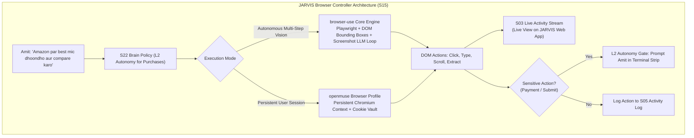

# JARVIS Research — 02_BROWSER.md
**Category**: Autonomous Browser Automation (Items 13 to 14)  
**Target Squad**: S15 (Browser Controller)  
**Lead Architect**: Senior Research + Architecture Agent  
**Status**: Batch 1 In-Depth Analysis Complete  

---

## 1. Architectural Synthesis: Autonomous Web Navigation in JARVIS

JARVIS Squad S15 (`S15_BROWSER.md`) covers Cloud Browser, Web Navigation, Tab Management, Page Reading, Form Filling, Product Comparison, Downloads, Saved Sessions, aur Browser History.

---

## 2. In-Depth Item Notes (Items 13 to 14)

---

### 13. browser-use (browser-use/browser-use)
- **Official Link**: [https://github.com/browser-use/browser-use](https://github.com/browser-use/browser-use)
- **Kya Hai**: Open-source, production-grade autonomous web browsing agent jo Playwright aur vision LLMs ka use karke kisi bhi website par human ki tarah interact, navigate, aur form fill karta hai.
- **Problem Hal Karta Hai, Fayda & Kamiyan**:
  - *Problem*: Traditional web scraping APIs modern JavaScript-heavy, dynamic, aur multi-step auth websites par fail ho jaati hain.
  - *Fayda*:
    - High success rate: Interactive elements ko numeric bounding boxes (`[1]`, `[2]`, `[3]`) se index karta hai.
    - Multi-tab management, cookie persistence, automated CAPTCHA detection, structured data extraction.
    - Works with any model (Gemini, Claude, GPT-4o, local Ollama).
  - *Kamiyan*: High token consumption (har step par screenshot aur annotated DOM tree jaati hai); fast-changing single-page apps par kabhie loop mein fas sakta hai.
- **Platform, License & Last Update**:
  - *Platform*: Python, Playwright, Chromium (Cross-platform Linux/Mac/Windows/Docker).
  - *License*: MIT.
  - *Last Update*: Extremely Active (top trending repo).
- **Kaise Kaam Karta Hai**:
  - `BrowserContext` start hota hai (Playwright headless ya headed).
  - Webpage ka accessibility tree aur visual screenshot liya jata hai.
  - Interactive elements par numbered labels attach hote hain.
  - Vision model next action decide karta hai: `click(14)`, `input_text(22, "laptop")`, `scroll()`, `switch_tab()`.
- **Setup Complexity**: **Easy** (`pip install browser-use playwright && playwright install`).
- **Security & Risk Matrix**:
  - *Permissions*: Network, headless browser execution, cookie handling.
  - *Code Execution*: Sandboxed inside Playwright Chromium.
  - *Sensitive Data*: User logins, browsing cookies.
  - *Risk Level*: **High if ungated**. In JARVIS, buying products, submitting forms, or deleting accounts **MUST BE HARD-CAPPED AT L2 AUTONOMY**.
- **JARVIS Mein Fitment**:
  - *Mapped Squad*: **S15 (Browser Controller)**.
  - *Feature*: S15 ke saare 9 sub-features (cloud-browser, web-navigation, tab-management, page-reading, form-filling, product-comparison, downloads, saved-sessions, browser-history) ka direct underlying engine!
- **JARVIS Mein Pehle Se Kya Hai vs Ye Behtar Kaise Hai**:
  - JARVIS mein `features/browser/` ke folders planned hain (`manifest.json` + `KNOWLEDGE.md`), lekin actual browser agent engine likha nahi gaya tha. `browser-use` zero-reinvention solution hai.
- **FAISLA**: **LO (Seedha Kaam Ka - Flagship Engine)**. S15 Browser squad ke worker backend mein `browser-use` ko as the primary automation engine import karo.

---

### 14. openmuse (CopilotKit/openmuse)
- **Official Link**: [https://github.com/CopilotKit/openmuse](https://github.com/CopilotKit/openmuse)
- **Kya Hai**: Open-source, self-hostable personal AI assistant application jo chat interface ko persistent Chromium browser, sandboxed Linux terminal, aur Google workspace integrations (Gmail, Calendar) ke saath bind karta hai.
- **Problem Hal Karta Hai, Fayda & Kamiyan**:
  - *Problem*: Isolated browser agents user ke normal email/calendar workflows aur mobile apps se disconnected hote hain.
  - *Fayda*: Fullstack architecture (TypeScript, Hono API, Expo / React Native mobile + web UI, persistent browser state); AG-UI interactive components.
  - *Kamiyan*: Heavy CopilotKit dependency tree; full stack deployment requires configuring multiple sub-services.
- **Platform, License & Last Update**:
  - *Platform*: TypeScript, Hono, React Native / Expo, Web.
  - *License*: MIT.
  - *Last Update*: Active.
- **Kaise Kaam Karta Hai**:
  - Backend Hono server persistent browser session manage karta hai.
  - AG-UI protocol se live browser screenshots aur interactive form cards frontend chat window mein push karta hai.
- **Setup Complexity**: **Medium**.
- **Security & Risk Matrix**:
  - *Risk Level*: **Medium**. Google OAuth tokens handle karta hai.
- **JARVIS Mein Fitment**:
  - *Mapped Squad*: **S15 (Browser)** & **S07 (Chat)**.
  - *Feature*: Live browser session streaming into JARVIS UI chat window.
- **JARVIS Mein Pehle Se Kya Hai vs Ye Behtar Kaise Hai**:
  - JARVIS ka approved UI already fix hai, isliye iska frontend replace nahi hoga. Lekin iska Hono + persistent browser session bridge pattern S15 ke liye bohot informative hai.
- **FAISLA**: **SEEKHO (Sirf Idea Lo)**. Persistent browser session caching aur live-view streaming ka pattern lo; poora CopilotKit bundle import mat karo.

---

## 3. Batch 1 Browser Summary & Recommendation Table

| # | Item Name | Category | Primary Fitment | Recommendation |
|---|---|---|---|---|
| **13** | **browser-use** | Browser | S15 (Browser) | **LO**: Primary execution engine for S15 autonomous web navigation; wrap with L2 confirmation for form submits. |
| **14** | **openmuse** | Browser | S15, S07 | **SEEKHO**: Persistent session state & live view stream patterns. |
