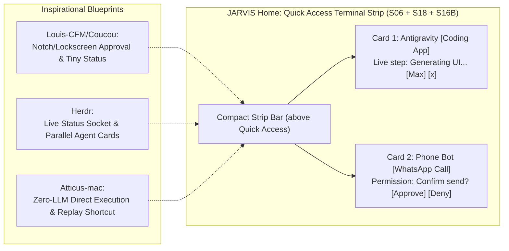

# JARVIS Research — 02_CONTROL.md
**Category**: Computer-Phone Control & UI Strips (Items 6 to 12)  
**Target Squad**: S16A (Hands-Android), S16B (Hands-Brain), S06 (Quick Access), S17 (Devices), S18 (Workbench)  
**Lead Architect**: Senior Research + Architecture Agent  
**Status**: Batch 1 In-Depth Analysis Complete  

---

## 1. Architectural Synthesis: Amit's "Terminal Strip" & Mobile Phone Control

Amit ne naya idea diya tha:
> *"Home par Quick Access ke upar chhota 'terminal strip': task dene par dikhe JARVIS kya kar raha hai (jaise app banana: Antigravity khulna, prompt dena, code banna). Chhota icon card, bada karne ka button, wapas ka button, 2-3 kaam saath chalein, permission ek line mein wahin."*

### Key Integration Decisions for Terminal Strip:
1. **Coucou Integration**: Coucou ka design pattern (ek chhota capsule widget jo lockscreen ya top strip par rehta hai aur 1-line interactive permission mangta hai: `[Approve]` / `[Reject]`) directly JARVIS Home par Quick Access ke upar fit hota hai.
2. **Multi-Task Concurrency (2–3 Kaam Saath Chalein)**: Strip multiple active mini-cards support karegi (e.g., card 1: Antigravity building app, card 2: Android phone downloading APK). Maximize button dabane par modal popup khulega jo full terminal output dikhayega, aur wapas dabane par minimize hokar wapas compact strip ban jayega.
3. **Safety Gate Alignment**: Risky actions (level L2) par execution freeze hogi aur terminal strip mein hi highlighted warning ke saath `[Approve]` button aayega. Kill switch trigger hone par strip instant red hokar saare active jobs halt kar degi.

---

## 2. In-Depth Item Notes (Items 6 to 12)

---

### 6. Agent Desktop (Prism Labs)
- **Official Link**: [github.com/prism-labs/agent-desktop](https://github.com/prism-labs/agent-desktop)
- **Kya Hai**: Open-source cross-platform computer-use infrastructure jo AI agents ko macOS, Windows, aur Linux desktops par safe GUI manipulation, mouse/keyboard events, aur screen parsing provide karta hai.
- **Problem Hal Karta Hai, Fayda & Kamiyan**:
  - *Problem*: Pure visual coordinate-based computer use slow hota hai aur resolution badalne par toot jata hai.
  - *Fayda*: Cross-platform native OS accessibility APIs ko coordinate fallback ke saath combine karta hai; safe execution boundaries banata hai.
  - *Kamiyan*: Heavy desktop system daemon chalana padta hai; accessibility permissions setup karna पड़ता hai.
- **Platform, License & Last Update**:
  - *Platform*: macOS, Windows, Linux.
  - *License*: Apache-2.0 / MIT.
  - *Last Update*: Active (late 2026).
- **Kaise Kaam Karta Hai**:
  - Local OS accessibility tree (UIAutomation Windows, AXUIElement macOS, AT-SPI Linux) ko parse karta hai.
  - Agent commands ko native OS events mein translate karta hai: `click_element`, `type_text`, `scroll`.
- **Setup Complexity**: **Medium** (Requires system accessibility permissions).
- **Security & Risk Matrix**:
  - *Permissions*: High (Accessibility permissions, screen recording, input simulation).
  - *Risk Level*: **High** if unconstrained. Must be gated at **L2 Autonomy** with confirmation.
- **JARVIS Mein Fitment**:
  - *Mapped Squad*: **S16B (Hands-Brain)** & **S17 (Devices - Desktop)**.
  - *Feature*: Desktop PC automation layer alongside phone control.
- **JARVIS Mein Pehle Se Kya Hai vs Ye Behtar Kaise Hai**:
  - JARVIS ke paas Android ke liye `S16A_HANDS-ANDROID.md` hai, lekin desktop PC control ke liye native framework nahi tha. Agent Desktop desktop companion ban sakta hai.
- **FAISLA**: **SEEKHO + REFERENCE**. Desktop PC control feature (Phase 3 S17 Devices) ke time iske accessibility patterns ko reuse karenge.

---

### 7. Coucou (Louis-CFM/coucou)
- **Official Link**: [https://github.com/Louis-CFM/coucou](https://github.com/Louis-CFM/coucou)
- **Kya Hai**: Mac notch aur mobile lockscreen companion utility jo background AI coding agents (Claude Code, Cursor, Codex) ke status ko monitor karta hai aur 1-line interactive permission approvals allow karta hai.
- **Problem Hal Karta Hai, Fayda & Kamiyan**:
  - *Problem*: Agent background mein chal raha ho toh baar-baar terminal switch karke dekhna padta hai ki kya kar raha hai ya kahan atka hai.
  - *Fayda*: Zero-friction notification; screen ke top par ya phone lockscreen par live token/step progress dikhata hai; 1-tap `[Allow]` / `[Deny]` permission button.
  - *Kamiyan*: Native Mac notch app Swift mein likha hai (cross-platform web app nahi hai).
- **Platform, License & Last Update**:
  - *Platform*: macOS (Swift), companion web/mobile notifications.
  - *License*: MIT.
  - *Last Update*: Active.
- **Kaise Kaam Karta Hai**:
  - Agent CLI se hooks / IPC socket ke through event stream sunta hai (`agent.step`, `permission.requested`).
  - Notch mein pulse karta hai aur interactive card render karta hai.
- **Setup Complexity**: **Easy**.
- **Security & Risk Matrix**:
  - *Telemetry*: Zero.
  - *Risk Level*: **Extremely Safe** (Approval gatekeeper hai, action executor nahi).
- **JARVIS Mein Fitment**:
  - *Mapped Squad*: **S06 (Quick Access / Terminal Strip)** & **S16A/B**.
  - *Feature*: Amit ke naye "Terminal Strip" aur Android phone approval notification ka blueprint!
- **JARVIS Mein Pehle Se Kya Hai vs Ye Behtar Kaise Hai**:
  - JARVIS ke paas approval policy (L2) thi, lekin Home UI par compact non-intrusive live strip nahi thi. Coucou ka UI interaction model exact solution hai.
- **FAISLA**: **LO (Blueprint & UI Pattern Seedha Kaam Ka)**. Coucou ka design aur socket approval protocol JARVIS web app ke Quick Access Terminal Strip aur Android companion notification mein copy karo.

---

### 8. Atticus-mac (SaarthurR/atticus-mac)
- **Official Link**: [https://github.com/SaarthurR/atticus-mac](https://github.com/SaarthurR/atticus-mac)
- **Kya Hai**: Hold-to-talk voice assistant jo commands ko LLM bypass karke deterministic shortcuts mein cache kar leta hai ("learn once, replay forever").
- **Problem Hal Karta Hai, Fayda & Kamiyan**:
  - *Problem*: Simple routine tasks (e.g. "open Chrome and play song") par har baar LLM call lagane se delay (3-8 seconds) aur paisa/tokens waste hote hain.
  - *Fayda*: First time agent step-by-step execute karta hai; success hone par exact sequence ko local deterministic macro mein convert kar leta hai; next time <50ms mein bina LLM call ke run hota hai!
  - *Kamiyan*: macOS specific AppleScript/native hooks use karta hai.
- **Platform, License & Last Update**:
  - *Platform*: macOS (Python/Swift).
  - *License*: MIT.
  - *Last Update*: Active.
- **Kaise Kaam Karta Hai**:
  - Global hotkey press (`⌃⌥Space`).
  - Local fast ASR.
  - Intent cache check: Agar matched sequence mil gaya, seedha execute; nahi toh agent planner ko bhejta hai.
- **Setup Complexity**: **Easy**.
- **Security & Risk Matrix**:
  - *Risk Level*: **Medium** (Replayed macros must still check JARVIS kill-switch and L2 caps).
- **JARVIS Mein Fitment**:
  - *Mapped Squad*: **S16B (Hands-Brain)**, **S06 (Quick Actions)**, **S12 (Automation)**.
  - *Feature*: Routine macro compilation for phone and web tasks.
- **JARVIS Mein Pehle Se Kya Hai vs Ye Behtar Kaise Hai**:
  - JARVIS S16B phone control mein har tap ke liye LLM call avoid karne ka yeh perfect blueprint hai.
- **FAISLA**: **SEEKHO (Sirf Idea Lo)**. "Learn once, replay deterministically" pattern ko JARVIS S16B aur S12 automations mein implement karo.

---

### 9. OpenBot (nightly-labs/openbot / ob-f/OpenBot)
- **Official Link**: [https://github.com/nightly-labs/openbot](https://github.com/nightly-labs/openbot) (AI Coworkers) | [https://github.com/ob-f/OpenBot](https://github.com/ob-f/OpenBot) (Smartphone Robotics)
- **Kya Hai**:
  - *Primary Candidate (`nightly-labs/openbot`)*: Self-hostable desktop workspace jo AI agents (Codex, Claude) ko dedicated task queues, isolated file workspaces, aur browser control deta hai.
  - *Secondary Candidate (`ob-f/OpenBot`)*: Android smartphone ko robot body ka "brain" banane wala open-source robotics stack.
- **Problem Hal Karta Hai, Fayda & Kamiyan**:
  - *Problem*: Multiple agents ko bina workspace conflict ke background tasks run karwana mushkil hota hai.
  - *Fayda*: Isolated task queues, multi-agent collaboration, local desktop control.
  - *Kamiyan*: Node/Electron heavy application.
- **Platform, License & Last Update**:
  - *License*: MIT / Apache-2.0.
  - *Last Update*: Active.
- **JARVIS Mein Fitment**:
  - *Mapped Squad*: **S14 (Bots)**, **S16A (Hands-Android)**.
- **JARVIS Mein Pehle Se Kya Hai vs Ye Behtar Kaise Hai**:
  - JARVIS ke S14 Bots squad ke background worker execution model se match karta hai.
- **FAISLA**: **REFERENCE (Baad Mein Kaam Aayega)**. Multi-agent desktop workspace design ke waqt reference ke roop mein dekho.

---

### 10. Expo "eas simulator --platform ios"
- **Official Link**: [https://docs.expo.dev/eas/simulator](https://docs.expo.dev)
- **Kya Hai**: Expo Application Services (EAS) ka official CLI tool jo developers aur automated agents ko bina local Mac hardware ke cloud ya local headless iOS simulator instances run karne deta hai.
- **Problem Hal Karta Hai, Fayda & Kamiyan**:
  - *Problem*: Linux/Windows machines par iOS apps test karna namumkin hota hai bina physical iPhone ya expensive Mac ke.
  - *Fayda*: Cloud-streamed iOS simulator build verification, automated UI smoke testing.
  - *Kamiyan*: EAS cloud builds require Expo account and internet connectivity.
- **Platform, License & Last Update**:
  - *Platform*: CLI (cross-platform Node.js).
  - *License*: MIT / Commercial Expo cloud.
  - *Last Update*: Active.
- **Setup Complexity**: **Easy** (`npm i -g eas-cli`).
- **Security & Risk Matrix**:
  - *Risk Level*: **Low**. Safe build tooling.
- **JARVIS Mein Fitment**:
  - *Mapped Squad*: **S20 (QA)** & **S16A (Hands Mobile)**.
  - *Feature*: Mobile companion testing and simulator preview.
- **JARVIS Mein Pehle Se Kya Hai vs Ye Behtar Kaise Hai**:
  - JARVIS currently focuses on physical Android devices (`Infinix Note 11S`). Future iOS expansion ke liye EAS simulator ready-made pipeline deta hai.
- **FAISLA**: **REFERENCE (Baad Mein Kaam Aayega)**. Jab JARVIS companion ko iOS par port ya QA karna ho, tab reference library se use karein.

---

### 11. CLI-Anything (clianything.cc / HKUDS/CLI-Anything)
- **Official Link**: [https://github.com/HKUDS/CLI-Anything](https://github.com/HKUDS/CLI-Anything) | Hub: [https://clianything.cc](https://clianything.cc)
- **Kya Hai**: Open-source framework jo traditional desktop GUI software (GIMP, Blender, LibreOffice, Inkscape, media tools) ko automated 7-phase pipeline se agent-ready CLI tools with structured `--json` outputs mein badal deta hai.
- **Problem Hal Karta Hai, Fayda & Kamiyan**:
  - *Problem*: AI agents ko complex software chalane ke liye screen par pixel-level clicks karne padte hain, jo unstable aur slow hote hain.
  - *Fayda*: Unstable GUI automation ko robust, fast, scriptable CLI commands mein replace kar deta hai jisme structured JSON return hota hai.
  - *Kamiyan*: Har app ke liye CLI wrapper harness generate karna padta hai.
- **Platform, License & Last Update**:
  - *Platform*: Linux, macOS, Windows (Python).
  - *License*: MIT.
  - *Last Update*: Very Active (late 2026).
- **Setup Complexity**: **Medium**.
- **Security & Risk Matrix**:
  - *Risk Level*: **Medium** (Runs shell commands on host). Gated behind **L2 Autonomy** in JARVIS.
- **JARVIS Mein Fitment**:
  - *Mapped Squad*: **S18 (AI Workbench)** & **S16B (Hands-Brain)**.
  - *Feature*: Expanding JARVIS's command-line powers to control local software without GUI overhead.
- **JARVIS Mein Pehle Se Kya Hai vs Ye Behtar Kaise Hai**:
  - JARVIS mein `packages/terminal-hub` aur `packages/contracts` hain. CLI-Anything ka structured `--json` generation pattern JARVIS library items ke liye ideal hai.
- **FAISLA**: **LO (Seedha Kaam Ka)**. JARVIS terminal agent ko complex desktop software wrap karne ke liye CLI-Anything harnesses use karne chahiye.

---

### 12. Barehands (jaredrhod/barehands)
- **Official Link**: [https://github.com/jaredrhod/barehands](https://github.com/jaredrhod/barehands)
- **Kya Hai**: Webcam-powered hand-tracking spatial interface jo users ko bina kisi headset ya controller ke apne haathon se screen ke floating notes, images aur 3D models ko pinch, throw aur resize karne deta hai (Iron Man hologram style).
- **Problem Hal Karta Hai, Fayda & Kamiyan**:
  - *Problem*: Futuristic AI assistants (Tony Stark style) keyboard/mouse par confined rehte hain.
  - *Fayda*: Pure browser WebGL / MediaPipe computer vision running locally; zero hardware cost; futuristic spatial interactions.
  - *Kamiyan*: Hand tracking lighting aur camera quality par depend karta hai; continuous camera feed battery/CPU consume karta hai.
- **Platform, License & Last Update**:
  - *Platform*: Browser (JavaScript, MediaPipe, Three.js).
  - *License*: MIT.
  - *Last Update*: Active.
- **Setup Complexity**: **Easy** (Browser camera permission only).
- **Security & Risk Matrix**:
  - *Permissions*: Camera access (local processing, no cloud streaming).
  - *Risk Level*: **Low / Safe**.
- **JARVIS Mein Fitment**:
  - *Mapped Squad*: **S18 (Workbench)** & **App / UI HUD**.
  - *Feature*: Optional Iron Man gesture control mode in AI Workbench.
- **JARVIS Mein Pehle Se Kya Hai vs Ye Behtar Kaise Hai**:
  - JARVIS ka UI approved aur final hai. Barehands ko global UI par impose nahi kiya ja sakta, lekin AI Workbench ke canvas/spatial mode mein ek optional "Gesture Mode" plugin ban sakta hai.
- **FAISLA**: **REFERENCE (Baad Mein Kaam Aayega)**. Core JARVIS build ke baad ek crazy power / easter egg mode ke liye reference library mein rakhein.

---

### 73. ARTEMIS (google/artemis)
- **Official Link**: [https://github.com/google/artemis](https://github.com/google/artemis)
- **Kya Hai**: Google ka open-source autonomous Android automation aur verification system (17,000+ GitHub stars, Apache-2.0). Natural-language commands ko high-accuracy phone operations mein convert karta hai, 99%+ AndroidWorld benchmark success rate ke saath, aur native Model Context Protocol (MCP) server deta hai.
- **Problem Hal Karta Hai, Fayda & Kamiyan**:
  - *Problem*: Mobile screen par apps dynamic hoti hain (screen resolution drift, shifting coordinates, auto-dismissing popups/toasts, keyboard overlays). Traditional coordinate-based automation crash ho jaati hai. JARVIS S16A (Hands-Android) ko reliably phone operate karne ke liye closed-loop perception engine chahiye.
  - *Fayda*:
    - **Dual Speed Loops**: Flash Mode (reactive 3–5s observe-think-act for simple tasks) aur Pro Mode (multi-agent plan-execute-verify-summarize for deep tasks).
    - **Dynamic-First, Coordinate-Fallback**: XML UIAutomator hierarchy se robust element locating, visual coordinate fallback ke saath.
    - **Transient UI Busting**: Fast-action bursts aur `click_sequence` chaining se auto-fading control bars aur ephemeral toasts capture karta hai.
    - **Native MCP Server**: Directly Antigravity, Claude Code, aur JARVIS backends se connect hota hai (`mobile_run_task`, `mobile_diagnose`, `mobile_get_device_state`).
    - **System Diagnostics**: Built-in ADB commands, Logcat stream monitoring, screen recording analysis, aur automatic crash recovery.
  - *Kamiyan*: Pro mode continuous visual reasoning ke dauran extra tokens le sakta hai; real physical phone par USB debugging ya WiFi ADB connection zaroori hai.
- **Platform, License & Last Update**:
  - *Platform*: Android (Physical devices & Emulators/AVD via ADB), Python 3.12+ host engine, Native MCP.
  - *License*: Apache License 2.0 (Google open-source).
  - *Last Update*: Active (Nov 2026, 17,063 stars).
- **Architecture & Main Modules**:
  - 1. *Device Lock & Manager*: `DeviceExecutionLock` managing multi-device allocation and mutual exclusion.
  - 2. *FlashRunner*: Single-LLM reactive loop chaining taps without graph overhead.
  - 3. *Pro Graph Orchestrator*: Planner (living markdown milestones) -> Operator (screen analysis + tool execution) -> Safety Net (pre-execution XML/pixel verification) -> Checker (visual audit & assertions).
  - 4. *Diagnostics*: Self-healing ADB restart, RSA key regeneration, and queue ticket cleanup.
- **Setup Complexity**: **Medium** (`git clone https://github.com/google/artemis.git && ./start.sh`).
- **Security & Risk Matrix**:
  - *Permissions*: Android ADB shell, input tap/swipe/keyevent, UI hierarchy dump, screencap.
  - *Threat*: Unintended actions on sensitive apps (banking, messaging, deletions).
  - *Mandatory Safety Gate*: **L2 Capped**. Safe app launches, navigation, and read-only searches run at L3/L4; any payment, checkout, or message deletion triggers an interactive confirmation on Amit's Terminal Strip before firing. Strictly complies with the **Universal 3-Tier App Launch Law**.
- **JARVIS Mein Fitment**:
  - *Mapped Squad*: **S16A (Hands-Android - Phone Control)** & **S22 (Brain - Autonomy Execution)**.
  - *Feature*: S16A Phone Control ka core execution engine banega. Coucou terminal strip ke zariye approval milega, aur Artemis device par action execute karega.
- **JARVIS Mein Pehle Se Kya Hai vs Ye Behtar Kaise Hai**:
  - JARVIS S16A ke paas basic ADB wrappers aur Small JARVIS companion intent scripts the, lekin 99% reliable closed-loop visual reasoning, transient UI handling, aur self-diagnosing execution incident logging nahi thi. Artemis transforms S16A into a production-grade autonomous phone pilot.
- **FAISLA**: **LO (Seedha Kaam Ka)**. S16A Hands-Android squad ka primary phone automation engine.

---

## 3. Batch 1 Control Summary & Recommendation Table

| # | Item Name | Category | Primary Fitment | Recommendation |
|---|---|---|---|---|
| **6** | **Agent Desktop** | Control | S16B, S17 | **SEEKHO + REFERENCE**: Cross-platform desktop OS accessibility patterns. |
| **7** | **Coucou** | Control | S06 (Quick Strip), S16A/B | **LO (Blueprint)**: Terminal Strip & 1-line interactive permission approvals blueprint. |
| **8** | **Atticus-mac** | Control | S16B (Hands-Brain), S12 | **SEEKHO**: "Learn once, replay deterministically" macro pattern. |
| **9** | **OpenBot** | Control | S14, S16A | **REFERENCE**: AI coworker desktop workspace patterns. |
| **10** | **Expo eas simulator** | Control | S20 (QA), S16A | **REFERENCE**: Cloud iOS simulator testing pipeline. |
| **11** | **CLI-Anything** | Control | S18 (Workbench) | **LO**: Convert heavy GUI software into agent-friendly JSON CLI commands. |
| **12** | **Barehands** | Control | S18 (Workbench) | **REFERENCE**: Optional Iron Man gesture control in AI Workbench. |
| **73**| **ARTEMIS** | Control | S16A (Hands-Android), S22 | **LO (Core Engine)**: Google's 99%+ AndroidWorld autonomous phone automation framework. |
