# JARVIS Research — 02_MEMORY.md
**Category**: Memory & Context Compression (Items 1 to 5)  
**Target Squad**: S09 (Memory + Knowledge), S05 (Recent History), S18 (Workbench)  
**Lead Architect**: Senior Research + Architecture Agent  
**Status**: Batch 1 In-Depth Analysis Complete  

---

## 1. Deep Dive: Honcho vs. mem0 vs. JARVIS Existing Memory

Amit ne vishesh roop se poocha tha: *"Honcho kaise memory banata hai, mem0 se farak kya hai, aur JARVIS mein kya lena chahiye?"*

```mermaid
flowchart TD
    subgraph HonchoFlow ["Honcho (Plastic Labs) - Theory of Mind"]
        H1["Peer-to-Peer Interaction<br/>(User, Agent, Group)"] --> H2["FastAPI Ingestion"]
        H2 --> H3["Asynchronous Background 'Dreams'<br/>(omni, card_refresh, reconciliation)"]
        H3 --> H4["Durable Conclusions & Behavioral Profiles<br/>(What Peer A knows about Peer B)"]
        H4 --> H5["PostgreSQL + pgvector + Redis"]
    end

    subgraph Mem0Flow ["mem0 (mem0ai) - Personalized Entity Graph"]
        M1["Conversation Turn"] --> M2["LLM Fact Extraction"]
        M2 --> M3["Entity Graph & Attribute Resolution<br/>(Add / Update / Delete / Deduplicate)"]
        M3 --> M4["Hybrid Storage<br/>(Qdrant/Milvus Vector + Neo4j Graph + SQLite)"]
    end

    subgraph JarvisExisting ["JARVIS Existing (S09 + packages/db)"]
        J1["Perceive & Chat Loop (S07/S22)"] --> J2["Structured Kind Classification<br/>(profile, person, project, episode, fact, preference, routine, knowledge)"]
        J2 --> J3["Supabase PostgreSQL public.memories<br/>(confidence, tags, vector(768), RLS)"]
        J3 --> J4["Fast Semantic Recall (Cosine Similarity)"]
    end
```

### Detailed Architectural Comparison:

| Feature Dimension | Plastic Labs **Honcho** | mem0ai **mem0** | JARVIS Existing (`packages/db`) |
|---|---|---|---|
| **Core Paradigm** | **Peer-to-Peer Theory of Mind**: Sirf text yaad nahi karta, balki yeh model karta hai ki *"User agent ke bare mein kya sochta hai aur agent user ke bare mein kya jaanta hai"*. | **Personalized Entity Graph**: Explicit entity-relationship extraction (e.g., `Amit -> prefers -> dark mode`, `Amit -> lives in -> Delhi`). | **Typed Life Knowledge Base**: 8 categorical kinds (`profile`, `person`, `project`, `episode`, `fact`, `preference`, `routine`, `knowledge`). |
| **Extraction Loop** | **Asynchronous "Dreams"**: Background worker queue (Redis) chala kar sessions reconcile karta hai aur "Conclusions" derive karta hai. | **Synchronous / Pipeline Extraction**: Turn khatam hote hi memory extraction call chalti hai jo facts add/update karti hai. | **S22 Loop Learn Phase**: Autonomy loop ke ant mein `learn` step ke dauran facts save hote hain. |
| **Backend Stack** | FastAPI + SQLAlchemy + PostgreSQL (`pgvector`) + Redis. Self-hosting requires multi-container Docker compose. | Python SDK / Cloud API. Local mode uses SQLite + Chroma/Qdrant + optional Neo4j. | **Pure Supabase**: 1 managed serverless Postgres database with `pgvector(768)` and Row-Level Security (RLS). Zero Redis, zero extra servers. |
| **Resource Cost** | **Heavy**: Continuous background LLM calls ("dreams") burn tokens to synthesize profiles. | **Medium**: Turn-by-turn extraction adds 1 LLM call per turn if not carefully throttled. | **Light / Zero Extra Cost**: Uses local embeddings or batch worker jobs, strictly staying inside Supabase 500MB free tier. |
| **Best Architectural Takeaway for JARVIS** | **SEEKHO (Idea Lo)**: Honcho ka "Conclusion derivation" aur "Peer profiling" concept bohot powerful hai. JARVIS ko iska heavy Python/Redis server nahi lagana hai, balki S09 ke periodic background worker (`worker/jobs`) mein ek light "Dream reconciliation" cron banana chahiye jo din bhar ki chat se user preferences derive kare. | **SEEKHO (Idea Lo)**: mem0 ka update/deduplication logic (existing memory ko overwrite/merge karna taaki contradictory facts na rahein) JARVIS ke `memories` table ke confidence score ke saath merge kiya ja sakta hai. | **PEHLE-SE-ADVANCED**: JARVIS ka schema already Supabase production par live hai, RLS protected hai, aur 8 typed kinds support karta hai. |

---

## 2. In-Depth Item Notes (Items 1 to 5)

---

### 1. Honcho (plastic-labs/honcho)
- **Official Link**: [https://github.com/plastic-labs/honcho](https://github.com/plastic-labs/honcho) | Docs: [https://honcho.dev/docs/v3](https://honcho.dev/docs/v3)
- **Kya Hai**: Stateful AI agents ke liye multi-agent memory aur continuous user-modeling server jo background reasoning ("dreams") se identity aur preferences extract karta hai.
- **Problem Hal Karta Hai, Fayda & Kamiyan**:
  - *Problem*: Traditional RAG sirf raw text chunks dhoondhta hai; agent user ki badalti thinking ya relationship nahi samajh pata.
  - *Fayda*: Peer-to-peer modeling, cross-agent memory sharing, automatic background distillation.
  - *Kamiyan*: Heavy infrastructure requirement (Docker, Redis, PostgreSQL, FastAPI); background dreams bohot saare LLM tokens consume karte hain.
- **Platform, License & Last Update**:
  - *Platform*: Linux/Docker, Python FastAPI, TypeScript/Python SDKs.
  - *License*: Apache-2.0.
  - *Last Update*: Active (v3 release late 2026).
- **Kaise Kaam Karta Hai**:
  - Messages `sessions` mein ingest hote hain.
  - Asynchronous derivers background mein "dreams" run karte hain: `card_refresh` (user card update), `omni` (semantic extraction), aur `reconciliation`.
  - Insights ko `conclusions` aur `metaphors` ke roop mein PostgreSQL `pgvector` mein store kiya jata hai.
- **Setup Complexity**: **Hard** (requires Docker compose with PostgreSQL, pgvector extension, Redis queue, and FastAPI app).
- **Security & Risk Matrix**:
  - *Permissions*: Network database access.
  - *Code Execution*: No arbitrary code execution.
  - *Telemetry*: Minimal.
  - *Sensitive Data*: User transcripts and personal facts store hote hain.
  - *API Key*: Stored in `.env` for LLM background calls.
- **JARVIS Mein Fitment**:
  - *Mapped Squad*: **S09 (Memory + Knowledge)** and **S22 (Brain - Learn Phase)**.
  - *Feature*: Background memory derivation concept.
- **JARVIS Mein Pehle Se Kya Hai vs Ye Behtar Kaise Hai**:
  - JARVIS mein Supabase par `public.memories` table already live hai (`extensions.vector(768)`). Honcho ka peer concept behtar hai, lekin infrastructure JARVIS ke lightweight serverless model ke liye zyada bhari hai.
- **FAISLA**: **SEEKHO (Sirf Idea Lo)**. Honcho ka architecture padh kar iska "Conclusion & Profile Derivation" logic JARVIS ke TypeScript worker (`worker/jobs`) mein implement karo, par Honcho ka poora Python/Docker stack install mat karo.

---

### 2. mem0 (mem0ai/mem0)
- **Official Link**: [https://github.com/mem0ai/mem0](https://github.com/mem0ai/mem0)
- **Kya Hai**: Self-improving personalized memory layer jo user, session, aur AI agent levels par facts aur graph relationships dynamically extract aur update karta hai.
- **Problem Hal Karta Hai, Fayda & Kamiyan**:
  - *Problem*: Chat history context window bhar deti hai; purane facts bhool jate hain ya duplicate ho jate hain.
  - *Fayda*: Automatic deduplication, entity extraction, graph + vector hybrid search, simple SDK (`mem0.add()`, `mem0.search()`).
  - *Kamiyan*: Cloud platform paid hai; open-source library multi-database setup mangti hai; custom entity linking mein token overhead hota hai.
- **Platform, License & Last Update**:
  - *Platform*: Python, Node.js SDK, REST API.
  - *License*: Apache-2.0.
  - *Last Update*: Very Active (Weekly releases).
- **Kaise Kaam Karta Hai**:
  - Input text ko LLM parser se guzar kar structured facts banata hai (`ADD`, `UPDATE`, `DELETE`).
  - Purane facts ke saath compare karke agar contradiction ho toh purana fact replace kar deta hai.
  - Graph database (Neo4j/SQLite) mein entity relations aur Vector database mein embeddings save karta hai.
- **Setup Complexity**: **Medium** (pip install mem0ai, vector store configure karo).
- **Security & Risk Matrix**:
  - *Permissions*: DB storage.
  - *Code Execution*: None.
  - *Sensitive Data*: Personal memory facts.
  - *API Key*: LLM provider key used for extraction.
- **JARVIS Mein Fitment**:
  - *Mapped Squad*: **S09 (Memory + Knowledge)**.
  - *Feature*: Deduplication and entity attribute updating in `public.memories`.
- **JARVIS Mein Pehle Se Kya Hai vs Ye Behtar Kaise Hai**:
  - JARVIS ke paas `kind in ('preference','fact','routine'...)` hai par automatic conflict resolution (agar Amit kahe "mujhe chai pasand hai" aur baad mein kahe "maine chai chhod di") mem0 mein automated hai.
- **FAISLA**: **SEEKHO (Sirf Idea Lo)**. mem0 ka deduplication prompt aur conflict resolution algorithm adopt karo; separate library dependecy ki zaroorat nahi hai.

---

### 3. Codebase Memory MCP (DeusData/codebase-memory-mcp)
- **Official Link**: [https://github.com/DeusData/codebase-memory-mcp](https://github.com/DeusData/codebase-memory-mcp)
- **Kya Hai**: Open-source Model Context Protocol (MCP) server jo poore code repository ko Tree-sitter se parse karke local SQLite AST knowledge graph banata hai.
- **Problem Hal Karta Hai, Fayda & Kamiyan**:
  - *Problem*: Coding agents (jaise Claude Code, Antigravity) har baar poori directory mein `grep` karke hazaron tokens waste karte hain aur function call chains miss karte hain.
  - *Fayda*: Single binary, zero cloud, zero API keys; functions, classes, imports, call paths ko graph query (`get_node`, `call_hierarchy`) se instant deta hai.
  - *Kamiyan*: Sirf code repositories par kaam karta hai (general text memory nahi hai).
- **Platform, License & Last Update**:
  - *Platform*: Cross-platform (Rust/C single binary, MCP standard).
  - *License*: MIT.
  - *Last Update*: Active.
- **Kaise Kaam Karta Hai**:
  - Local repo ke source code ko Tree-sitter AST parser se scan karta hai.
  - Symbols, imports, aur call edges ko local SQLite database mein store karta hai.
  - MCP tools expose karta hai: `find_symbol`, `get_callers`, `get_dependencies`.
- **Setup Complexity**: **Easy** (single binary command ya MCP config entry).
- **Security & Risk Matrix**:
  - *Permissions*: Read-only local file system access.
  - *Code Execution*: None. Safe AST parsing only.
  - *Telemetry*: None. 100% local.
  - *Risk Level*: **Extremely Low**.
- **JARVIS Mein Fitment**:
  - *Mapped Squad*: **S18 (Workbench)** & **S11 (Extend)**.
  - *Feature*: JARVIS ka terminal coding agent feature (jab Amit code modify karne ko kahe).
- **JARVIS Mein Pehle Se Kya Hai vs Ye Behtar Kaise Hai**:
  - JARVIS ke paas abhi code-graph indexing nahi hai (sirf standard file read tools hain). Ye coding tasks mein token consumption ko 70% kam kar deta hai.
- **FAISLA**: **LO (Seedha Kaam Ka)**. JARVIS ke MCP configuration mein add kiya ja sakta hai taaki S18 AI Workbench codebases ko instantaneously navigate kar sake.

---

### 4. claude-mem (thedotmack/claude-mem)
- **Official Link**: [https://github.com/thedotmack/claude-mem](https://github.com/thedotmack/claude-mem)
- **Kya Hai**: AI coding assistants (Claude Code, Codex, Cursor) ke liye persistent cross-session memory aur context compression system.
- **Problem Hal Karta Hai, Fayda & Kamiyan**:
  - *Problem*: Har naya terminal session blank shuru hota hai; pichle session ke architectural decisions aur bug fixes bhool jate hain.
  - *Fayda*: Background process tool usage aur decisions ko watch karti hai, compress karti hai, aur agle session mein prompt inject karti hai.
  - *Kamiyan*: Background watcher process CPU/disk use karta hai; irrelevant history inject hone par prompt bloat ho sakta hai.
- **Platform, License & Last Update**:
  - *Platform*: Node.js / CLI, cross-platform.
  - *License*: MIT.
  - *Last Update*: Active.
- **Kaise Kaam Karta Hai**:
  - Session transcript ledger maintain karta hai.
  - AI compression se key summaries banata hai: *Decisions made, bugs encountered, verified commands*.
  - Next session start par targeted markdown inject karta hai.
- **Setup Complexity**: **Easy** (`npx` / npm install).
- **Security & Risk Matrix**:
  - *Permissions*: Terminal session logs reading.
  - *Code Execution*: None.
  - *Telemetry*: None.
  - *Risk Level*: **Low**.
- **JARVIS Mein Fitment**:
  - *Mapped Squad*: **S05 (Recent History)** & **S09 (Memory)**.
  - *Feature*: Session-to-session memory bridge for JARVIS terminal coding agent.
- **JARVIS Mein Pehle Se Kya Hai vs Ye Behtar Kaise Hai**:
  - JARVIS mein `activity_log` aur `sessions` table hai, lekin auto-compression prompt injection nahi hai.
- **FAISLA**: **SEEKHO (Sirf Idea Lo)**. claude-mem ka session-summarizer pattern JARVIS S05 activity log mein directly code kiya ja sakta hai.

---

### 5. Second Brain (Sebastian Hardy Agent Concept)
- **Official Link**: [Concept Reference / Sebastian Hardy Architecture](https://sebastianhardy.ai)
- **Kya Hai**: AI-powered personal knowledge management system jo unstructured thoughts, bookmarks, audio transcripts, aur meeting notes ko categorize aur synthesize karta hai.
- **Problem Hal Karta Hai, Fayda & Kamiyan**:
  - *Problem*: Rozana aane wali information (links, voice notes, articles) bikhar jati hai aur jarurat par nahi milti.
  - *Fayda*: Automated tagging, thematic clustering, weekly synthesis newsletters.
  - *Kamiyan*: Agar active retrieval prompts na hon toh database ek "data graveyard" ban jata hai.
- **Platform, License & Last Update**:
  - *Platform*: Architectural Pattern (Notion/AppFlowy/Supabase integration).
  - *License*: Conceptual (Open architecture).
- **Kaise Kaam Karta Hai**:
  - Ingestion: Voice memos (via Whisper), Web clips, Markdown notes.
  - Synthesis: Knowledge graphs aur associative linking.
  - Retrieval: Morning briefing ya daily focus recommendations.
- **Setup Complexity**: **Medium** (Workflow design).
- **Security & Risk Matrix**:
  - *Risk Level*: **Safe** (Internal database only).
- **JARVIS Mein Fitment**:
  - *Mapped Squad*: **S09 (Personal Knowledge Base)**, **S04 (Insight)**, **S08 (Today Tasks)**.
- **JARVIS Mein Pehle Se Kya Hai vs Ye Behtar Kaise Hai**:
  - JARVIS S09 squad ka exact target yahi hai. Sebastian Hardy ka proactive synthesis workflow (e.g., Sunday Weekly Review) JARVIS ke S04 Insight cron mein add hona chahiye.
- **FAISLA**: **SEEKHO (Sirf Idea Lo)**. JARVIS S09 aur S04 ki proactivity rules mein implement karo.

---

## 3. Batch 1 Memory Summary & Recommendation Table

| # | Item Name | Category | Primary Fitment | Recommendation |
|---|---|---|---|---|
| **1** | **Honcho** | Memory | S09 (Memory) | **SEEKHO**: Profile & conclusion derivation idea lo; heavy Docker/Redis stack mat lagao. |
| **2** | **mem0** | Memory | S09 (Memory) | **SEEKHO**: Entity conflict-resolution & overwrite pattern lo. |
| **3** | **Codebase Memory MCP** | Memory | S18 (Workbench) | **LO**: Local AST graph indexing tool for coding tasks; single binary zero-risk. |
| **4** | **claude-mem** | Memory | S05 (History) | **SEEKHO**: Session compression & automatic context re-injection pattern. |
| **5** | **Second Brain** | Memory | S09, S04 | **SEEKHO**: Proactive weekly synthesis & auto-tagging workflows. |
