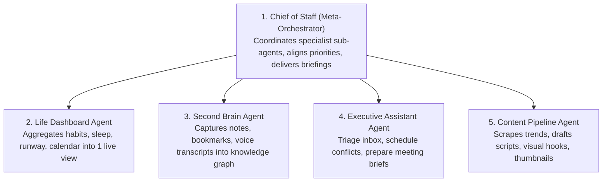

# JARVIS Research — 02_NOTES.md
**Category**: Video & Document Notes Synthesis (Group C Deep Dive)  
**Target Squad**: S00 (Arch), S22 (Brain), S14 (Bots), S11 (Extend), S18 (Workbench)  
**Lead Architect**: Senior Research + Architecture Agent  
**Status**: Batch 3 In-Depth Analysis Complete  

---

## 1. Executive Overview of Group C Notes

Group C mein 6 specific video and document notes the jinme architectural patterns, self-hosted tools, aur multi-agent workflows shamil hain:
- **Note 1**: Project Chrysalis (Governed Self-Evolution)
- **Note 2**: Herdr (Boss + Helper Multiplexing)
- **Note 3**: 10 Production Open-Source Alternatives
- **Note 4**: Claude Code ke 5 High-Leverage Plugins
- **Note 5**: Teardown Skill (3D Machine Simulation)
- **Note 6**: Sebastian Hardy ke 5 Essential AI Agents

---

## 2. In-Depth Breakdown of Each Note

---

### Note 1: Project Chrysalis (Google Cloud Generative AI)
- **Core Problem**: Production incidents (jaise cache thundering herds, distributed database deadlocks) fast evolve hote hain. Static hardcoded scripts har situation ke liye available nahi hote.
- **The 4-Step Self-Evolving Loop**:
  1. *Root Cause Diagnosis*: Distributed metrics aur logs se bottleneck identify karta hai.
  2. *Runtime Tool Synthesis*: Naya Python/TypeScript mitigation code khud generate karta hai.
  3. *Marginal Impact Evaluation (Shapley Score)*: Game theory algorithms se calculate karta hai ki kya naye tool ne system performance improve ki ya downstream microservices par side-effects dale.
  4. *Governance Gate (OPA + Human Approval)*: Open Policy Agent (OPA) ke strict boundaries mein sandboxed execute hota hai, aur production par apply karne se pehle human SRE sign-off demand karta hai.
- **JARVIS Application**:
  - JARVIS S22 Brain squad ke paas jab kisi user task ke liye tool missing ho (jaise "Convert this specific proprietary binary format"), tab JARVIS sandboxed tool likh sakta hai, par execution se pehle Amit se **L2 confirmation** mangega: *"Maine yeh script generate ki hai, kya ise execute karoon? [Approve] [Cancel]"*.

---

### Note 2: Herdr (herdr.dev)
- **Core Concept**: Boss-and-Helper Agent Architecture with a Live Status Sidebar.
- **Key Modules & Mechanics**:
  - `HERDR_ENV=1`: Environment socket expose karta hai jisse running agents terminal layout ko programmatically inspect aur split kar sakte hain.
  - *Supervisor ("Boss") Agent*: High-level prompt receive karta hai, subtasks identify karta hai, aur background panes mein helper agents ko spawn karta hai (`herdr workspace create`, `herdr pane split`).
  - *Live State Multiplexer*: Sidebar ya API socket par live status emit karta hai:
    - 🟢 `working` (active generation/tool execution)
    - 🟡 `blocked` (waiting for human confirmation / tool approval)
    - ⚪ `idle` (task complete, standing by)
- **JARVIS Application**:
  - Directly powers Amit's **Home Quick Access Terminal Strip**! JARVIS Core (Boss) background tasks (Antigravity coding, phone automation) ko sub-jobs ki tarah dispatch karega aur strip par Herdr-style live indicators dikhayega.

---

### Note 3: 10 Open-Source Alternatives (Full Analysis)

| # | Tool Name | Proprietary Equivalent Replaced | Core Power & Architecture | JARVIS Alignment & Decision |
|---|---|---|---|---|
| **1** | **OpenWhispr** | Wispr Flow / MacWhisper | Local Whisper voice dictation into any application field | S21 Persona / Voice dictation (**SEEKHO**) |
| **2** | **Activepieces** | Zapier / Make.com | Self-hosted TypeScript workflow automation with 200+ pieces | S12 Automation engine for explicit "har baar" routines (**LO**) |
| **3** | **Stirling-PDF** | Adobe Acrobat Pro | 100% local PDF manipulation suite (OCR, merge, redact) | S18 Workbench document utility (**REFERENCE**) |
| **4** | **Kdenlive** | Adobe Premiere Pro | Open-source NLE video editing powered by MLT & FFmpeg | "THE AI ALGORITHM" scripted rendering (**REFERENCE**) |
| **5** | **Actual Budget** | YNAB (You Need A Budget) | Local-first encrypted personal finance & envelope budget | S10 Insights & Boards finance card (**REFERENCE**) |
| **6** | **Immich** | Google Photos | Self-hosted photo/video backup with facial recognition | S17 Devices media synchronization (**REFERENCE**) |
| **7** | **Meetily** | Otter.ai / Fireflies.ai | Local meeting recorder, Whisper transcription & action items | S09 Memory & S08 Tasks meeting notes (**SEEKHO**) |
| **8** | **Dub** | Bitly / Rebrandly | Modern branded link management, custom domains & analytics | Marketing & YouTube channel link shortener (**REFERENCE**) |
| **9** | **Documenso** | DocuSign | Open-source cryptographic digital signatures | S18 Workbench client contract signing (**REFERENCE**) |
| **10**| **Vaultwarden** | 1Password / LastPass | Ultra-lightweight Rust Bitwarden server (<30MB RAM) | S19 System / Vault secure password storage (**LO**) |

---

### Note 4: Claude Code ke 5 Essential Plugins
1. **Agent Skills (`addyosmani/agent-skills`)**:
   - Addy Osmani's 24 engineering lifecycle skills enforcing strict specification, planning, local CI verification, mutation testing, and trunk-based shipping.
   - *Verdict*: **LO (Gold Standard for S18)**.
2. **Context7 (`upstash/context7`)**:
   - Injects real-time, fresh documentation for modern frameworks (Next.js 15, Tailwind v4, Supabase v2) directly into model prompt, eliminating hallucinated deprecated APIs.
   - *Verdict*: **LO (Essential Developer MCP)**.
3. **Graphify (`graphifyy/graphify`)**:
   - Converts large codebases into queryable AST dependency knowledge graphs, reducing token overhead by up to 70x.
   - *Verdict*: **LO (Repository Understanding Tool)**.
4. **21st MCP (`21st-dev/magic-mcp`)**:
   - Searches and injects 10,000+ modern React/Tailwind/shadcn UI components directly from 21st.dev into the codebase.
   - *Verdict*: **LO (Design-Clone SaaS & UI Widgets Tool)**.
5. **Strix (`usestrix/strix`)**:
   - Autonomous AI penetration testing platform discovering vulnerabilities, generating validated exploit PoCs, and writing fix PRs in Docker sandbox.
   - *Verdict*: **LO (Security & RLS Auditor for S19)**.

---

### Note 5: Teardown Skill (3D Machine Simulator Workflow)
- **What It Does**: Description ya schematics se interactive 3D WebGL exploded-view machine models aur 60fps disassembly MP4 videos produce karta hai.
- **Workflow**:
  1. *Subsystem Decomposition*: Machine ko logical mechanical parts (rotor, stator, housing, bearings) mein break karta hai.
  2. *Procedural Geometry & Mesh Synthesis*: Lightweight Three.js code generate karta hai.
  3. *Camera Animation*: Exploded view slider aur dynamic cinematic camera rotations render karta hai.
  4. *Audio & Video Export*: Synchronized audio ke saath automated video recording export karta hai.
- **JARVIS Value**: Content creation engine for "THE AI ALGORITHM" YouTube tutorials.

---

### Note 6: "The 5 AI Agents You Need To Build Right Now" (Sebastian Hardy)

#### Detailed Breakdown & JARVIS Alignment:
1. **Chief of Staff**: The master coordinator. In JARVIS, this is **S22 Brain** (owns autonomy levels L0-L4, power registry, and thinking loops).
2. **Life Dashboard**: Aggregates personal KPIs. In JARVIS, this is the **Approved UI Home Screen** (`jarvis-lovat-one.vercel.app`) with Focus rings, Today's Tasks, and Schedule widgets.
3. **Second Brain**: Knowledge graph and long-term memory. In JARVIS, this is **S09 Memory + Knowledge** (`public.memories` with `pgvector`).
4. **Executive Assistant**: Calendar triage and communications. In JARVIS, this is **S02 Schedule** and **S08 Tasks**.
5. **Content Agent**: Dedicated creative assistant. In JARVIS, this is an **S14 Bot preset** customized for "THE AI ALGORITHM" YouTube channel workflows.
