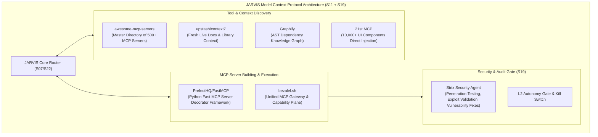

# JARVIS Research — 02_PLUGINS.md
**Category**: Plugins, Model Context Protocol (MCP) & Security (Items 39 to 45)  
**Target Squad**: S11 (Extend - Skills & Plugins), S19 (System & Safety), S18 (Workbench)  
**Lead Architect**: Senior Research + Architecture Agent  
**Status**: Batch 2 In-Depth Analysis Complete  

---

## 1. Architectural Synthesis: The Model Context Protocol (MCP) in JARVIS

JARVIS Squad S11 (`S11_EXTEND.md`) aur `packages/mcp-server` ka maqsad hai: *Connectors, Plugins, External API integrations, aur Tool Registries*.

---

## 2. In-Depth Item Notes (Items 39 to 45)

---

### 39. awesome-mcp-servers (punkpeye/awesome-mcp-servers)
- **Official Link**: [https://github.com/punkpeye/awesome-mcp-servers](https://github.com/punkpeye/awesome-mcp-servers)
- **Kya Hai**: Community-curated directory of 500+ Model Context Protocol (MCP) servers categorized by domain (Databases, File Systems, Cloud, Developer Tools, Browsing, Productivity, Social).
- **Problem Hal Karta Hai, Fayda & Kamiyan**:
  - *Problem*: Har service (Slack, GitHub, Postgres, Google Drive, Docker) ke liye alag se custom tool connector likhna padta tha.
  - *Fayda*: Ready-made standard servers; one-click configuration in MCP clients.
  - *Kamiyan*: Quality varies; community servers mein kabhie token leaks ya unmaintained code ho sakta hai.
- **Platform, License & Last Update**:
  - *Platform*: Markdown catalog / GitHub.
  - *License*: CC0 / Open Public Domain.
  - *Last Update*: Continuously updated.
- **Security & Risk Matrix**:
  - *Risk Level*: **Catalog is Safe**, but individual third-party MCP servers must be vetted before installation.
- **JARVIS Mein Fitment**:
  - *Mapped Squad*: **S11 (Extend - Connectors & Plugins)**.
  - *Feature*: JARVIS S11 ke "Plugin & MCP Directory" ka reference catalog.
- **JARVIS Mein Pehle Se Kya Hai vs Ye Behtar Kaise Hai**:
  - JARVIS mein `public.library_items` table hai. Ye directory us table ke liye verified preset data deti hai.
- **FAISLA**: **REFERENCE (Master MCP Directory)**. Baad mein jab Amit koi specific integration maange (e.g. "Postgres inspect karo" ya "Slack bot"), tab is directory se server select hoga.

---

### 40. context7 (upstash/context7)
- **Official Link**: [https://github.com/upstash/context7](https://github.com/upstash/context7) | [https://context7.com](https://context7.com)
- **Kya Hai**: Model Context Protocol (MCP) server aur dynamic context engine jo AI coding agents ko popular software libraries (Next.js 15, Tailwind v4, Drizzle, Vite 6, Supabase v2) ki bilkul **fresh, up-to-date documentation** directly inject karta hai.
- **Problem Hal Karta Hai, Fayda & Kamiyan**:
  - *Problem*: LLM ka training cutoff purana hota hai; naye frameworks ke deprecated APIs (jaise Next.js 13 pages router vs app router, ya Tailwind v3 vs v4 syntax) hallucinate karke code break kar dete hain.
  - *Fayda*: Real-time documentation fetch; zero hallucinations on new framework versions; instant version-specific code examples.
  - *Kamiyan*: Requires active internet connection to query Upstash index.
- **Platform, License & Last Update**:
  - *Platform*: TypeScript, Node.js MCP server (`npx -y @upstash/context7-mcp`).
  - *License*: MIT.
  - *Last Update*: Very Active.
- **Setup Complexity**: **Easy** (Single line in MCP config).
- **Security & Risk Matrix**:
  - *Permissions*: Outbound HTTPS to context7.com documentation API.
  - *Risk Level*: **Low / Safe**. Read-only documentation provider.
- **JARVIS Mein Fitment**:
  - *Mapped Squad*: **S11 (Extend)** & **S18 (AI Workbench)**.
  - *Feature*: Coding assistant reference engine.
- **JARVIS Mein Pehle Se Kya Hai vs Ye Behtar Kaise Hai**:
  - JARVIS coding karte waqt agar kisi modern package (e.g. latest Supabase JS SDK) par kaam kare, toh context7 ensures ki zero deprecated functions generate hon.
- **FAISLA**: **LO (Seedha Kaam Ka - Essential MCP Tool)**. JARVIS terminal coding agent ke MCP configuration mein add karein.

---

### 41. FastMCP (PrefectHQ/fastmcp)
- **Official Link**: [https://github.com/PrefectHQ/fastmcp](https://github.com/PrefectHQ/fastmcp)
- **Kya Hai**: Prefect dwara banaya gaya ultra-simple, high-performance Python framework jo Python functions ko simple `@mcp.tool()` decorators ke zariye standard MCP servers mein convert kar deta hai.
- **Problem Hal Karta Hai, Fayda & Kamiyan**:
  - *Problem*: Official MCP SDK mein boilerplate protocol code, JSON-RPC schemas, aur error handling likhna bohot cumbersome hota hai.
  - *Fayda*: 5 lines of Python code mein complete MCP server ban jata hai; type hinting se automatic schema generation; integrated stdio and SSE transports.
  - *Kamiyan*: Python specific (JARVIS core is TypeScript, par worker jobs and CLI scripts can use Python).
- **Platform, License & Last Update**:
  - *Platform*: Python 3.10+, cross-platform.
  - *License*: Apache-2.0.
  - *Last Update*: Very Active (late 2026).
- **Setup Complexity**: **Instant** (`pip install fastmcp`).
- **Security & Risk Matrix**:
  - *Risk Level*: **Safe**. Developer framework.
- **JARVIS Mein Fitment**:
  - *Mapped Squad*: **S11 (Extend)**, **S00 (Arch)**, **packages/mcp-server**.
  - *Feature*: Building custom local MCP tools for JARVIS in minutes.
- **JARVIS Mein Pehle Se Kya Hai vs Ye Behtar Kaise Hai**:
  - JARVIS ke custom Python scripts (jaise phone ADB wrappers ya Whisper verification) ko MCP servers mein convert karne ka fastest tool hai.
- **FAISLA**: **LO (Seedha Kaam Ka - Tool Builder Framework)**. Python tools ko MCP banane ke liye FastMCP use karein.

---

### 42. bezalel.sh (bezalel.sh)
- **Official Link**: [https://bezalel.sh](https://bezalel.sh)
- **Kya Hai**: Unified capability plane aur hosted Model Context Protocol (MCP) gateway jo multiple apps (GitHub, Slack, Gmail, Notion), long-term memory, aur cloud sandboxes ko **ek single MCP endpoint (`https://bezalel.sh/api/mcp`) aur bearer token** ke peeche aggregate karta hai.
- **Problem Hal Karta Hai, Fayda & Kamiyan**:
  - *Problem*: Har naye agent (Claude, Cursor, Codex, OpenCode) ke liye 10 alag-alag MCP servers configure karna, authenticate karna aur API keys manage karna nightmare hota hai.
  - *Fayda*: One single endpoint configure karo; saari powers aur shared memory across all agents automatically available ho jaati hain.
  - *Kamiyan*: Third-party hosted service; bearer token required; privacy-conscious self-hosters might prefer direct local MCP servers.
- **Platform, License & Last Update**:
  - *Platform*: Streamable HTTP MCP, cross-client.
  - *Last Update*: Active.
- **Security & Risk Matrix**:
  - *Permissions*: Centralized token access to connected apps.
  - *Risk Level*: **Medium**. Storing third-party keys in external gateway.
- **JARVIS Mein Fitment**:
  - *Mapped Squad*: **S11 (Extend)** & **S00 (Arch)**.
- **JARVIS Mein Pehle Se Kya Hai vs Ye Behtar Kaise Hai**:
  - JARVIS khud ek self-hosted private companion hai (Amit's rule: Zero Paid APIs, local-first). Bezalel ka hosted model use karne ke bajaye uska *architecture* (ek central MCP router jo baaki tools ko route kare) JARVIS ke `packages/mcp-server` mein implement hona chahiye.
- **FAISLA**: **SEEKHO (Architecture Idea Lo)**. Unified endpoint pattern seekho, par external commercial service par depend mat raho.

---

### 43. Graphify (graphifyy/graphify)
- **Official Link**: [https://github.com/graphifyy/graphify](https://github.com/graphifyy/graphify)
- **Kya Hai**: Codebase knowledge graph builder aur MCP server jo AST parsing ke zariye codebases, documentation aur schemas ka deterministic structural map banata hai, jisse AI coding agents ka context token usage up to **70x reduce** ho jata hai.
- **Problem Hal Karta Hai, Fayda & Kamiyan**:
  - *Problem*: Bada codebase (jaise JARVIS monorepo with 23 squads) padhte waqt LLM ka 200k context window jaldi bhar jata hai aur rate limits hit hoti hain.
  - *Fayda*: Blind file reading aur grep ko replace karke seedha dependency graph queries (`get_neighbors`, `shortest_path`, `god_nodes`) chalata hai; deterministic (zero embedding hallucinations).
  - *Kamiyan*: Graph build hone mein initial 1-2 minute lagte hain.
- **Platform, License & Last Update**:
  - *Platform*: Python CLI / MCP server (`graphifyy`).
  - *License*: MIT.
  - *Last Update*: Active.
- **Setup Complexity**: **Easy** (`uv tool install graphifyy`).
- **Security & Risk Matrix**:
  - *Risk Level*: **Low / Safe**. Local AST code analysis.
- **JARVIS Mein Fitment**:
  - *Mapped Squad*: **S18 (AI Workbench)** & **S11 (Extend)**.
  - *Feature*: Accelerating JARVIS monorepo understanding for coding agents.
- **JARVIS Mein Pehle Se Kya Hai vs Ye Behtar Kaise Hai**:
  - JARVIS mein `packages/registry-builder` graph.json banata hai, par code-level AST dependency mapping Graphify mein zyada deep hai.
- **FAISLA**: **LO (Seedha Kaam Ka)**. Monorepo codebase navigation ke liye install karein.

---

### 44. 21st MCP (21st-dev/magic-mcp)
- **Official Link**: [https://github.com/21st-dev/magic-mcp](https://github.com/21st-dev/magic-mcp) | [https://21st.dev](https://21st.dev)
- **Kya Hai**: 21st.dev ka official Model Context Protocol server jo AI coding agents ko 10,000+ modern React, Tailwind CSS, shadcn/ui, aur Framer Motion UI components, animations, aur hooks ko seedha editor mein search aur install karne deta hai.
- **Problem Hal Karta Hai, Fayda & Kamiyan**:
  - *Problem*: AI agents generic, outdated, ya ugly CSS UI components generate karte hain.
  - *Fayda*: Production-grade, stunning animations aur micro-interactions (bento grids, spotlight cards, floating toolbars, glowing borders) copy-paste-ready inject karta hai.
  - *Kamiyan*: React/Tailwind specific hai.
- **Platform, License & Last Update**:
  - *Platform*: Node.js MCP server (`21st.dev/mcp`).
  - *License*: MIT.
  - *Last Update*: Very Active.
- **Setup Complexity**: **Easy**.
- **Security & Risk Matrix**:
  - *Risk Level*: **Low / Safe**. UI component injection.
- **JARVIS Mein Fitment**:
  - *Mapped Squad*: **S18 (AI Workbench)** & **App Development**.
  - *Feature*: Design-Clone SaaS project aur JARVIS feature cards development!
- **JARVIS Mein Pehle Se Kya Hai vs Ye Behtar Kaise Hai**:
  - JARVIS UI approved hai (usme badlav nahi hoga), lekin Amit ke "Design-Clone SaaS" project aur naye internal widgets (jaise Quick Access Terminal Strip) ke components craft karne ke liye 21st MCP super useful hai.
- **FAISLA**: **LO (Design-Clone & Widgets ke liye Seedha Kaam Ka)**.

---

### 45. Strix (usestrix/strix)
- **Official Link**: [https://github.com/usestrix/strix](https://github.com/usestrix/strix)
- **Kya Hai**: Open-source autonomous AI penetration testing aur application security platform jo code, APIs, aur live web applications mein vulnerabilities (SQLi, XSS, SSRF, RCE, IDOR, auth bypass) dhoondhta hai, validated exploit proof-of-concept generate karta hai, aur automatic fix PRs banata hai.
- **Problem Hal Karta Hai, Fayda & Kamiyan**:
  - *Problem*: Traditional static scanners (SAST) hazaron false positives dete hain jinko check karne mein ghanton lagte hain.
  - *Fayda*: Dynamic autonomous pentester running in sandboxed Kali Linux Docker container; validates exploits in real-time before reporting; generates exact code fixes.
  - *Kamiyan*: Powerful offensive tool; must never be pointed at unauthorized external servers.
- **Platform, License & Last Update**:
  - *Platform*: Python, Docker (Kali Linux sandbox), MCP support (`~/.strix/mcp-servers.json`).
  - *License*: AGPL-3.0 / Open Source.
  - *Last Update*: Very Active.
- **Setup Complexity**: **Medium / Hard** (Requires Docker).
- **Security & Risk Matrix**:
  - *Risk Level*: **CRITICAL / HIGH POWER**. Must be run strictly against local self-hosted targets.
  - *Autonomy Policy*: **Hard-capped at L0/L2**. Never allow autonomous scanning of external production domains without Amit's explicit confirmation.
- **JARVIS Mein Fitment**:
  - *Mapped Squad*: **S19 (System & Safety)** & **S20 (QA)**.
  - *Feature*: Autonomous security auditor for JARVIS endpoints, Supabase RLS policies, and user APIs.
- **JARVIS Mein Pehle Se Kya Hai vs Ye Behtar Kaise Hai**:
  - JARVIS ke paas unit tests (`npm run test:all`) hain par koi automated security penetration tester nahi hai jo RLS bypass ya prompt-injection attack vectors ko audit kar sake. Strix provides true offensive verification.
- **FAISLA**: **LO (Sandboxed Security Auditor)**. JARVIS ke local dev environments aur Supabase RLS security audit ke liye Strix integration rakhein.

---

## 3. Batch 2 Plugins & MCP Summary Table

| # | Item Name | Category | Primary Fitment | Recommendation |
|---|---|---|---|---|
| **39** | **awesome-mcp-servers**| Plugins | S11 (Extend) | **REFERENCE**: Master catalog of 500+ MCP servers. |
| **40** | **context7** | Plugins | S11, S18 | **LO**: Essential MCP for fresh, zero-hallucination library documentation. |
| **41** | **FastMCP** | Plugins | S11, S00 | **LO**: Fastest framework to turn Python scripts into typed MCP servers. |
| **42** | **bezalel.sh** | Plugins | S11, S00 | **SEEKHO**: Unified MCP capability plane pattern (avoid third-party cloud lock-in). |
| **43** | **Graphify** | Plugins | S18, S11 | **LO**: Codebase AST knowledge graph reducing context tokens by up to 70x. |
| **44** | **21st MCP** | Plugins | S18, Design-Clone | **LO**: Direct UI component injector for Design-Clone SaaS & widgets. |
| **45** | **Strix** | Plugins | S19 (Safety) | **LO**: Autonomous penetration testing agent for Supabase RLS & API security. |
