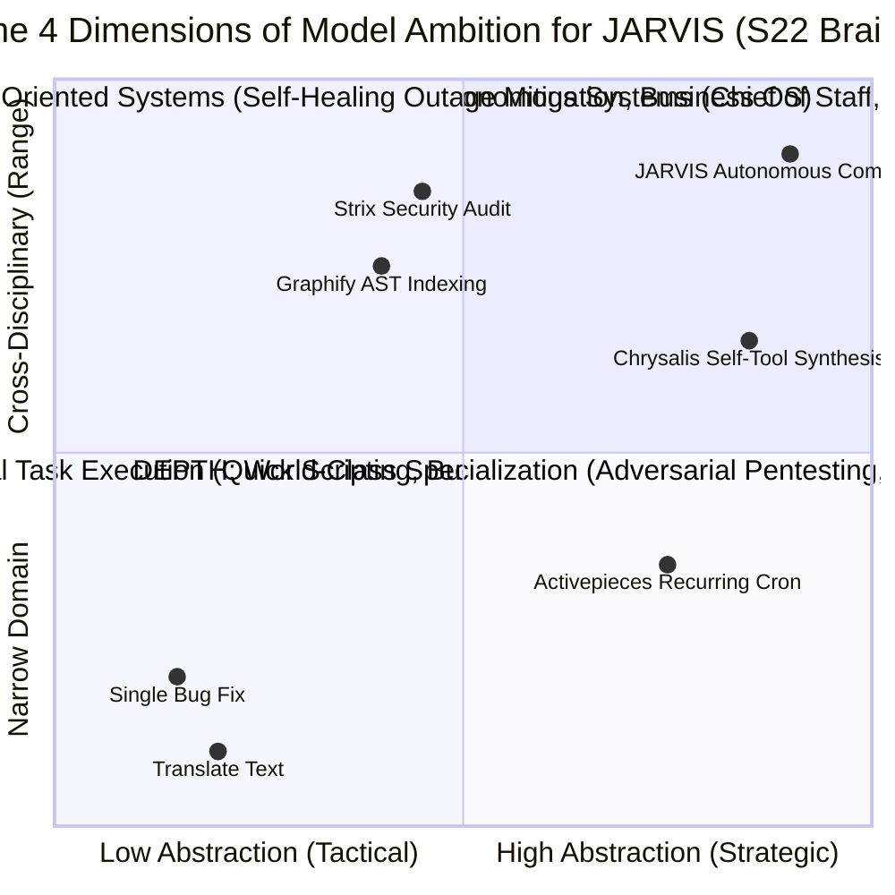

# JARVIS Research — 02_REFERENCE.md
**Category**: Reference Library & Architectural Philosophy (Items 70 to 71 + Catalogs)  
**Target Squad**: S22 (Brain Philosophy), Reference Library (`research/REFERENCE_LIBRARY.md`)  
**Lead Architect**: Senior Research + Architecture Agent  
**Status**: Batch 3 In-Depth Analysis Complete  

---

## 1. Architectural Philosophy: The 4 Dimensions of Agent Ambition

Felix Rieseberg (Anthropic engineering manager) ka essay *"How to be more ambitious: A tutorial for humans with models"* JARVIS ke brain design (S22) ke liye ek foundational guideline set karta hai:

### Key Principles for JARVIS S22 Brain:
1. **Speed**: Sirf wahi kaam jaldi karna jo pehle se kar rahe the (baseline).
2. **Altitude**: Level of abstraction upar le jana — *"Fix a single bug"* bolne ke bajaye *"Keep this entire monorepo crash-free and green"* ka goal lena.
3. **Depth**: Professional engineering tools demand karna (AST graphs, automated test suites, mutation tests), aur model ko apna homework khud grade karne na dena (external validator tool ya test suite zaroori hai).
4. **Range**: Cross-disciplinary perspective lana (security auditor, motion designer, systems engineer, technical writer) to solve complex workflows.

---

## 2. In-Depth Item Notes (Items 70 to 71)

---

### 70. awesome-llm-apps (Shubhamsaboo/awesome-llm-apps)
- **Official Link**: [https://github.com/Shubhamsaboo/awesome-llm-apps](https://github.com/Shubhamsaboo/awesome-llm-apps)
- **Kya Hai**: Curated collection of 100+ working production LLM applications with complete source code covering RAG, autonomous agents, multimodal AI, voice assistants, and enterprise workflows.
- **Problem Hal Karta Hai, Fayda & Kamiyan**:
  - *Problem*: Naye AI feature (jaise financial research bot, voice diary, ya video summarizer) banane ke liye zero se architecture design karna padta hai.
  - *Fayda*: 100+ end-to-end working code examples; clear framework recipes (LangChain, LlamaIndex, CrewAI, Phidata, Streamlit); permissive licenses.
  - *Kamiyan*: Kai apps third-party paid APIs (OpenAI, Anthropic) use karti hain jinhe JARVIS ke FOSS/local models se adapt karna hoga.
- **Platform, License & Last Update**:
  - *Platform*: Python, Streamlit, FastAPI, Docker.
  - *License*: Apache-2.0.
  - *Last Update*: Continuously updated.
- **Security & Risk Matrix**:
  - *Risk Level*: **Catalog is Safe**. Code can be read and learned from.
- **JARVIS Mein Fitment**:
  - *Mapped Squad*: **Reference Library** (`research/REFERENCE_LIBRARY.md`).
  - *Feature*: Recipe book for JARVIS when Amit asks to build a new agent or RAG pipeline.
- **FAISLA**: **REFERENCE (Master Recipe Book)**. Jab bhi Amit kahe "RAG app banao" ya "Medical research bot banao", tab JARVIS is repo ka code reference karega.

---

### 71. How to be more ambitious (Felix Rieseberg Essay)
- **Official Link**: [felixrieseberg.com/how-to-be-more-ambitious-a-tutorial-for-humans-with-models/](https://felixrieseberg.com/how-to-be-more-ambitious-a-tutorial-for-humans-with-models/)
- **Kya Hai**: Anthropic engineering manager Felix Rieseberg dwara likha gaya foundational essay jo explain karta hai ki models ko basic trivial prompt box ki tarah use karne ke bajaye unki Speed, Altitude, Depth aur Range ko kaise scale kiya jaye.
- **Problem Hal Karta Hai, Fayda & Kamiyan**:
  - *Problem*: Log AI ko sirf grocery list ya email polish karne ke liye use karte hain kyunki unhe higher-order delegation ka pattern nahi pata.
  - *Fayda*: Clear prompt templates jo model ko deep research aur adversarial self-verification karne par majboor karte hain; "Roger Bannister effect" mental model.
- **Platform, License & Last Update**:
  - *Type*: Architectural Essay.
  - *Published*: October 2026.
- **JARVIS Mein Fitment**:
  - *Mapped Squad*: **S22 (Brain Philosophy & Prompt Standards)**.
  - *Feature*: S22 Brain system prompts and planning discipline.
- **FAISLA**: **LO (Philosophical & Prompt Standard)**. Incorporate into S22 Brain prompt engineering guidelines.

---

## 3. Reference Library Catalog (Task Type to Repo Mapping)

Jab Amit JARVIS ko koi complex feature ya naya tool build karne ko kahein, tab JARVIS neeche diye catalog se reference le sakta hai:

| Task Type (Amit's Command) | Reference Repos / Tools | What JARVIS Can Learn / Take | License / Advice |
|---|---|---|---|
| **"Naya RAG Pipeline / Document QA Banao"** | `Shubhamsaboo/awesome-llm-apps` | Chunking strategies, hybrid vector-BM25 search, citations | Apache-2.0 (Code lene ki permission hai) |
| **"Multi-Agent Coding Swarm Chalao"** | `stablyai/orca`, `1jehuang/jcode` | Isolated Git worktrees, TUI multiplexing, split panes | MIT (Code aur architectural pattern lo) |
| **"Autonomous Sales / Lead Outreach Setup Karo"** | `ethanplusai/sellbird` | Website buying signal scraping, email verification, SQLite loop | MIT (Code adapt karein; enforce L2 send gate) |
| **"FOSS SaaS Replacement Dhoondho"** | `mustbeperfect/definitive-opensource` | Curated verified alternatives list, docker-compose templates | MIT (Catalog lookup) |
| **"Naya MCP Server Build Karo"** | `PrefectHQ/fastmcp`, `punkpeye/awesome-mcp-servers` | Fast Python `@mcp.tool` decorators, transport schemas | Apache-2.0 / CC0 (Directly use FastMCP) |
| **"Codebase ki Structure / Dependencies Index Karo"**| `graphifyy/graphify`, `DeusData/codebase-memory-mcp` | Tree-sitter AST parsing, SQLite symbol table | MIT (Local single binary tool) |
| **"Naya UI Component / Page Design Karo"** | `21st-dev/magic-mcp`, `penpot/penpot` | 10k+ Tailwind/React components, Framer Motion animations | MIT / MPL-2.0 (Component patterns import karein) |
| **"API Security ya RLS Audit Karo"** | `usestrix/strix` | Dynamic vulnerability auditing, exploit verification | AGPL-3.0 (Run in sandboxed Docker only) |
| **"Naye Bot ke liye System Persona Likho"** | `msitarzewski/agency-agents` | 230+ battle-tested persona briefs, domain rules | MIT (Copy-paste prompt templates) |
| **"3D Mechanical Exploded View / Video Banao"** | `elvarofficial/teardown`, `wheresryan22/anatomy` | Three.js exploded disassembly, isometric SVG models | MIT (Ready-to-use skills) |
| **"Voice Synthesis mein Emotion Dalo"** | `henryklunaris/hey-jev` | Fish Audio S2.1 emotion tags (`[chuckling]`, `[sighing]`) | MIT (Direct tag injection in voice pipeline) |
| **"Private Password / Key Vault Setup Karo"** | `dani-garcia/vaultwarden` | Zero-knowledge Rust vault, Bitwarden API compatibility | AGPL-3.0 (Run lightweight Docker container) |
| **"Automated PDF Bulk Processing Workflow"** | `Stirling-Tools/Stirling-PDF` | 100% local PDF manipulation REST endpoints | GPL-3.0 (Connect via REST API, do not modify core) |
| **"Self-Evolving Tool Synthesis with Safety Gates"**| `GoogleCloudPlatform/generative-ai` (Chrysalis) | Shapley impact scoring, OPA sandboxing, L2 confirmation | Apache-2.0 (Architecture implementation) |

*(Comprehensive indexed reference manual will be maintained in [`research/REFERENCE_LIBRARY.md`](file:///home/ubuntu/research/REFERENCE_LIBRARY.md)).*
