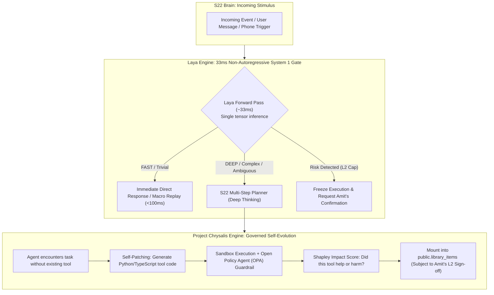

# JARVIS Research — 02_SELFLEARN.md
**Category**: Self-Evolving AI, Decision Models & Learning Harnesses (Items 61 to 63)  
**Target Squad**: S22 (Brain - Decision & Thinking Policy), S19 (System & Safety), S09 (Memory)  
**Lead Architect**: Senior Research + Architecture Agent  
**Status**: Batch 2 In-Depth Analysis Complete  

---

## 1. Architectural Synthesis: Governed Self-Evolution & 33ms System 1 Routing

JARVIS S22 Brain squad owns: *Thinking Loop, Thinking Depth Router (FAST/NORMAL/DEEP), Autonomy Levels (L0–L4), Power Registry, aur Prompt-Injection Defense*.

---

## 2. In-Depth Item Notes (Items 61 to 63)

---

### 61. learnharness (amosblomqvist/learnharness)
- **Official Link**: [https://github.com/amosblomqvist/learnharness](https://github.com/amosblomqvist/learnharness)
- **Kya Hai**: Open-source AI agent harness jo kisi bhi complex subject (math, distributed systems, quantum computing, system architecture) ko learn karne ke liye user ka knowledge map banata hai, gaps identify karta hai, aur adaptive step-by-step curriculum banata hai.
- **Problem Hal Karta Hai, Fayda & Kamiyan**:
  - *Problem*: LLM se padhte waqt user passive reader ban jata hai; pata nahi chalta ki concept samajh aaya ya nahi.
  - *Fayda*:
    - Socratic diagnostic questioning loop (prediction checks, edge case prompts).
    - Dynamic concept dependency graph (prerequisites track karta hai).
    - Persistent comprehension model (stores user's exact mental model in memory).
  - *Kamiyan*: Learning scenarios ke bahar general task automation mein direct role nahi hai.
- **Platform, License & Last Update**:
  - *Platform*: TypeScript, Node.js.
  - *License*: MIT.
  - *Last Update*: Active.
- **JARVIS Mein Fitment**:
  - *Mapped Squad*: **S09 (Personal Knowledge Base)** & **S22 (Brain - Learn Phase)**.
  - *Feature*: Socratic tutoring mode in JARVIS (jab Amit kisi naye topic ya tool ko deeply sikhna chahein).
- **JARVIS Mein Pehle Se Kya Hai vs Ye Behtar Kaise Hai**:
  - JARVIS mein conversational chat hai, lekin structured "pedagogical diagnostic loop" nahi tha jo user ki understanding ko mathematically test kar sake.
- **FAISLA**: **SEEKHO (Sirf Idea Lo)**. Socratic teaching loop aur prerequisite dependency mapping pattern S09/S18 mein adopt karein.

---

### 62. Project Chrysalis (GoogleCloudPlatform/generative-ai, agents/self-evolving-ai)
- **Official Link**: [GoogleCloudPlatform/generative-ai](https://github.com/GoogleCloudPlatform/generative-ai) | Research Paper / Architecture Reference
- **Kya Hai**: Google Cloud ki reference architecture for **Governed, Self-Evolving AI Agents** jo live production infrastructure incidents ke dauran autonomously naye mitigation tools likhte hain, unka marginal impact Shapley score se measure karte hain, aur Open Policy Agent (OPA) sandbox + human approval se govern hote hain.
- **Problem Hal Karta Hai, Fayda & Kamiyan**:
  - *Problem*: Traditional agents sirf wahi tools use kar sakte hain jo pehle se hardcoded hon. Agar koi unexpected failure aaye toh agent helpless ho jata hai.
  - *Fayda*:
    - **Self-Tool Synthesis**: Agent runtime par naya tool code generate karta hai.
    - **Shapley Impact Scoring**: Game theory se mathematically evaluate karta hai ki naye tool ne system behtar kiya ya side-effects create kiye.
    - **Strict OPA Governance**: Unconstrained self-modification ko rokta hai; mandatory human sign-off gate.
  - *Kamiyan*: Enterprise cloud scale (Gemini + BigQuery + OPA); personal companion ke liye lightweight implementation chahiye.
- **Platform, License & Last Update**:
  - *Platform*: Python, GCP Gemini, Open Policy Agent, Docker.
  - *License*: Apache-2.0.
  - *Last Update*: Active (Google Cloud GenAI ecosystem).
- **Security & Risk Matrix**:
  - *Risk Level*: **CRITICAL / HIGH POWER**. Writing self-executable tools is the definition of dangerous power.
  - *Autonomy Policy*: **Strictly Capped at L2 (Act after confirm)**. JARVIS must NEVER compile or register a self-synthesized tool without presenting the exact code diff and asking for Amit's explicit confirmation.
- **JARVIS Mein Fitment**:
  - *Mapped Squad*: **S22 (Brain - Tool Registry)** & **S19 (System & Safety)**.
  - *Feature*: The core blueprint for JARVIS's ultimate self-evolution capability!
- **JARVIS Mein Pehle Se Kya Hai vs Ye Behtar Kaise Hai**:
  - JARVIS ke paas `powers` aur `library_items` table hai, lekin dynamically naye tools invent karne ka self-healing engine nahi tha. Chrysalis is the gold standard for doing this safely.
- **FAISLA**: **LO (Architectural Blueprint for Governed Self-Evolution)**. Chrysalis ka (Tool Synthesis → Sandbox Validation → Shapley Critique → L2 Human Approval) loop JARVIS S22 mein implement karo.

---

### 63. Laya (NandhaKishorM/laya / aayushch/laya)
- **Official Link**: [https://github.com/NandhaKishorM/laya](https://github.com/NandhaKishorM/laya) (System 1 Decision Engine) | [https://github.com/aayushch/laya](https://github.com/aayushch/laya) (Command Center)
- **Kya Hai**:
  - *Primary Recommendation (`NandhaKishorM/laya`)*: Non-autoregressive "System 1" decision model designed for AI agent routing aur safety guardrails. Traditional LLMs ki tarah token-by-token generate karne ke bajaye, yeh single forward pass (~33ms) mein calibrated probabilities (choice, score, boolean) return karta hai.
  - *Secondary Project (`aayushch/laya`)*: Local-first command center jo Slack, Gmail, GitHub, aur Jira notifications aggregate karta hai.
- **Problem Hal Karta Hai, Fayda & Kamiyan**:
  - *Problem*: Har decision par (e.g. "Kya yeh command dangerous hai?", "Kya isme web search chahiye ya direct answer?") full LLM call lagane se 1-2 seconds ka delay aur high token cost aati hai.
  - *Fayda*: Ultra-low latency (~33ms ONNX / native Apple Silicon/Linux inference); deterministic mathematical confidence; zero hallucination in classification.
  - *Kamiyan*: Specialized classification/routing model hai (free-form generation nahi karta).
- **Platform, License & Last Update**:
  - *Platform*: Python, ONNX runtime, TypeScript (`@receptron/laya`), C++ (`laya.cpp`).
  - *License*: Open Source / MIT.
  - *Last Update*: Active.
- **Setup Complexity**: **Easy / Medium** (ONNX single file runner).
- **Security & Risk Matrix**:
  - *Risk Level*: **Extremely Safe**. Pure mathematical classification model running locally.
- **JARVIS Mein Fitment**:
  - *Mapped Squad*: **S22 (Brain - Thinking Depth Router)** & **S19 (Safety Guardrails)**.
  - *Feature*: The 33ms pre-execution router that classifies incoming requests into FAST vs DEEP thinking, and checks L0–L4 safety caps!
- **JARVIS Mein Pehle Se Kya Hai vs Ye Behtar Kaise Hai**:
  - JARVIS S22 Brain squad ke `THINKING DEPTH ROUTER` (FAST/NORMAL/DEEP) ke liye Laya sabse fast aur cost-effective engine hai. Har request par expensive LLM token kharch kiye bina instant routing ho sakti hai.
- **FAISLA**: **LO (Seedha Kaam Ka - 33ms S22 Depth Router Engine)**. Local ONNX runtime mein Laya model ko S22 pre-decision router ke taur par use karein.

---

## 3. Batch 2 Self-Learn Summary Table

| # | Item Name | Category | Primary Fitment | Recommendation |
|---|---|---|---|---|
| **61** | **learnharness** | Self-Learn | S09, S22 | **SEEKHO**: Socratic diagnostic questioning & knowledge dependency mapping. |
| **62** | **Project Chrysalis** | Self-Learn | S22, S19 | **LO (Blueprint)**: Governed self-evolving tool synthesis with OPA & L2 human gate. |
| **63** | **Laya** | Self-Learn | S22, S19 | **LO**: 33ms System 1 non-autoregressive router for S22 FAST/DEEP thinking & safety guardrails. |
