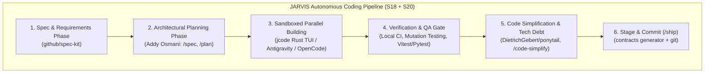

# JARVIS Research — 02_SKILLS.md
**Category**: Developer Skills & Autonomous Coding (Items 32 to 38)  
**Target Squad**: S18 (AI Workbench), S11 (Extend - Skills), S20 (QA), S00 (Arch)  
**Lead Architect**: Senior Research + Architecture Agent  
**Status**: Batch 2 In-Depth Analysis Complete  

---

## 1. Architectural Synthesis: S18 AI Workbench & Agent Coding Stack

Amit ne bataya tha: *"JARVIS khud ek CLI/terminal coding agent bhi hai."*  
S18 squad (`S18_WORKBENCH.md`) ka maqsad hai AI Workbench, code generation, terminal hubs, tool runners, aur verification.

---

## 2. In-Depth Item Notes (Items 32 to 38)

---

### 32. Ponytail (DietrichGebert/ponytail)
- **Official Link**: [https://github.com/DietrichGebert/ponytail](https://github.com/DietrichGebert/ponytail)
- **Kya Hai**: Specialized coding agent skill aur workflow jo codebase mein accumulated technical debt, obsolete TODOs, dead code branches, aur loose abstractions ko audit aur systematically refactor karta hai.
- **Problem Hal Karta Hai, Fayda & Kamiyan**:
  - *Problem*: Rapid development ke dauran codebase mein temporary hacks aur unused files jama ho jaati hain.
  - *Fayda*: Zero-loss refactoring; debt classification; incremental pull requests; non-breaking code cleanup.
  - *Kamiyan*: Aggressive cleanup par kabhie subtle dynamic dependencies toot sakti hain bina strict tests ke.
- **Platform, License & Last Update**:
  - *Platform*: Skill / CLI (compatible with Claude Code, Antigravity, Cursor).
  - *License*: MIT.
  - *Last Update*: Active.
- **Setup Complexity**: **Easy** (`npx skills add DietrichGebert/ponytail`).
- **Security & Risk Matrix**:
  - *Risk Level*: **Low / Safe** (Reads repo, suggests diffs, runs tests before commit).
- **JARVIS Mein Fitment**:
  - *Mapped Squad*: **S18 (AI Workbench)** & **S20 (QA)**.
  - *Feature*: Background maintenance routine (`.agent/workflows/` tech-debt cleaner).
- **JARVIS Mein Pehle Se Kya Hai vs Ye Behtar Kaise Hai**:
  - JARVIS mein `check.mjs` aur `FOLDER_FIRST_RULE.md` enforcement hai, par proactive code simplification aur dead code prune karne ke liye Ponytail automated heuristics deta hai.
- **FAISLA**: **LO (Seedha Kaam Ka)**. JARVIS repo maintenance aur AI Workbench ke liye ponytail skills permanently active rakhein.

---

### 33. Spec-Kit (github/spec-kit)
- **Official Link**: [https://github.com/github/spec-kit](https://github.com/github/spec-kit)
- **Kya Hai**: GitHub ka official Specification-Driven Development (SDD) toolkit jo AI coding agents ko code likhne se pehle formal specifications, acceptance criteria, aur schema contracts banane par majboor karta hai.
- **Problem Hal Karta Hai, Fayda & Kamiyan**:
  - *Problem*: AI agents prompt milte hi hasty code likhna shuru kar dete hain jo later stages par breaking changes lata hai.
  - *Fayda*: Strict spec-first workflow; automated test derivation from specs; API contract drift prevention.
  - *Kamiyan*: Small one-line fixes ke liye thoda formal overhead lagta hai.
- **Platform, License & Last Update**:
  - *Platform*: TypeScript, CLI, GitHub Actions.
  - *License*: MIT.
  - *Last Update*: Active (GitHub official).
- **Setup Complexity**: **Easy**.
- **JARVIS Mein Fitment**:
  - *Mapped Squad*: **S00 (Arch - Contracts)** & **S20 (QA)**.
  - *Feature*: `packages/contracts` generation and squad spec reviews.
- **JARVIS Mein Pehle Se Kya Hai vs Ye Behtar Kaise Hai**:
  - JARVIS already follows the "Folder-First rule" and strict Zod schemas (`packages/contracts`). Spec-kit validates that this philosophy matches GitHub's industry standard.
- **FAISLA**: **SEEKHO (Workflow Align Karo)**. Spec-first gatekeeper heuristics ko S18 mein enforce karein.

---

### 34. Agent Skills Pack (addyosmani/agent-skills)
- **Official Link**: [https://github.com/addyosmani/agent-skills](https://github.com/addyosmani/agent-skills)
- **Kya Hai**: Google ke ex-engineering lead Addy Osmani dwara banaya gaya 24-skill production lifecycle pack jo coding agents ko Google software engineering standards (Hyrum's Law, Beyoncé Rule, Test Pyramid, trunk-based development) follow karne par majboor karta hai.
- **Problem Hal Karta Hai, Fayda & Kamiyan**:
  - *Problem*: LLM coding assistants sloppy code, untested assumptions, aur unnecessary third-party dependencies add kar dete hain.
  - *Fayda*: 24 structured skills (`spec`, `plan`, `build`, `test`, `review`, `code-simplify`, `ship`) + 1 meta-skill `using-agent-skills`; anti-rationalization tables jo agent ke lazy excuses ko block karti hain.
  - *Kamiyan*: None. Pure markdown skill engineering at highest quality.
- **Platform, License & Last Update**:
  - *Platform*: Markdown skill standard (Claude Code, Cursor, Antigravity, OpenCode).
  - *License*: Apache-2.0.
  - *Last Update*: Very Active (widely adopted standard).
- **Setup Complexity**: **Instant** (`npx skills add addyosmani/agent-skills`).
- **Security & Risk Matrix**:
  - *Risk Level*: **Zero / Safe**. Pure engineering discipline rules.
- **JARVIS Mein Fitment**:
  - *Mapped Squad*: **S11 (Extend - Skills)**, **S18 (AI Workbench)**, **S20 (QA)**.
  - *Feature*: The default operating discipline for JARVIS terminal coding agent.
- **JARVIS Mein Pehle Se Kya Hai vs Ye Behtar Kaise Hai**:
  - Addy Osmani ke skills pack ke kai skills already local `.agents/skills/` mein maujood hain. Inko JARVIS ke command-center guidelines mein formally bake karna chahiye.
- **FAISLA**: **LO (Core Standard - Must Keep)**. Highly recommended as the gold standard for all coding tasks Amit gives to JARVIS.

---

### 35. jcode (1jehuang/jcode)
- **Official Link**: [https://github.com/1jehuang/jcode](https://github.com/1jehuang/jcode)
- **Kya Hai**: Rust-based ultra-fast terminal-first coding agent harness jisme interactive Text User Interface (TUI), multi-session daemon, multi-model BYOK support, aur unique "Self-Dev" mode hai.
- **Problem Hal Karta Hai, Fayda & Kamiyan**:
  - *Problem*: Heavy Electron or Node-based coding assistants machine ki 1–2 GB RAM consume karte hain aur multi-agent concurrency slow ho jati hai.
  - *Fayda*: Blazing fast (Rust compiled binary, <25MB RAM); self-development mode (agent apne hi binary ko compile, test, aur hot-reload kar sakta hai); model-agnostic.
  - *Kamiyan*: Requires Rust/Cargo environment to compile from source.
- **Platform, License & Last Update**:
  - *Platform*: Linux, macOS, Windows (Rust binary).
  - *License*: MIT.
  - *Last Update*: Active.
- **Setup Complexity**: **Medium** (`cargo install jcode`).
- **Security & Risk Matrix**:
  - *Risk Level*: **Medium**. Executes terminal commands on host. Capped at **L2 Autonomy** in JARVIS.
- **JARVIS Mein Fitment**:
  - *Mapped Squad*: **S18 (AI Workbench)** & **S14 (Bots)**.
  - *Feature*: Lightweight terminal worker engine when heavy assistants are overkill.
- **JARVIS Mein Pehle Se Kya Hai vs Ye Behtar Kaise Hai**:
  - JARVIS runs on TypeScript/Node. jcode's "Self-Dev" loop (code change -> compile -> test -> hot-reload) is a brilliant self-healing pattern.
- **FAISLA**: **SEEKHO + REFERENCE**. Study the Self-Dev mode loop; keep jcode binary in reference library for low-resource environments.

---

### 36. Codex (OpenAI Codex CLI Ecosystem)
- **Official Link**: [https://github.com/openai/codex](https://github.com/openai/codex)
- **Kya Hai**: OpenAI ka native CLI coding agent harness jo terminal sessions mein natural language prompts ko git diffs, shell commands, aur automated repo refactorings mein translate karta hai.
- **Problem Hal Karta Hai, Fayda & Kamiyan**:
  - *Problem*: Web browser interface se code download karke project mein paste karne ka friction.
  - *Fayda*: Native terminal presence; background app-server daemon; direct git staging.
  - *Kamiyan*: OpenAI model lock-in; subscription/API costs.
- **Platform, License & Last Update**:
  - *Platform*: Node.js / Python CLI, Linux/macOS.
  - *License*: Proprietary / MIT wrappers.
  - *Last Update*: Installed and active locally (`~/.codex`).
- **JARVIS Mein Fitment**:
  - *Mapped Squad*: **S18 (Workbench)**.
- **FAISLA**: **REFERENCE (Baad Mein Kaam Aayega)**. Already installed as a CLI backend on the system.

---

### 37. OpenCode (anomalyco/opencode)
- **Official Link**: [https://github.com/anomalyco/opencode](https://github.com/anomalyco/opencode)
- **Kya Hai**: Open-source, terminal-first autonomous AI coding assistant jo Claude, OpenAI, Gemini, aur local Ollama models ke through codebases ko explore, edit, aur test karta hai.
- **Problem Hal Karta Hai, Fayda & Kamiyan**:
  - *Problem*: Proprietary tools (Cursor, Copilot) user ko locked-in rakhte hain.
  - *Fayda*: 100% open-source, provider agnostic, terminal-native, extensible toolchain.
  - *Kamiyan*: Community project; ecosystem smaller than Claude Code.
- **Platform, License & Last Update**:
  - *Platform*: TypeScript / Node.js (Installed locally at `~/.opencode`).
  - *License*: MIT.
  - *Last Update*: Active.
- **JARVIS Mein Fitment**:
  - *Mapped Squad*: **S18 (AI Workbench)**.
- **FAISLA**: **REFERENCE (Baad Mein Kaam Aayega)**. Fully open-source terminal coding harness reference.

---

### 38. Antigravity (Google DeepMind Antigravity CLI)
- **Official Link**: [Google DeepMind Advanced Agentic Coding](https://deepmind.google)
- **Kya Hai**: Current environment running right now — an enterprise-grade agentic pair-programming engine featuring multi-turn planning, proactive reactive wakeups, deep file editing, background tasks, subagents, and integrated MCP support.
- **Problem Hal Karta Hai, Fayda & Kamiyan**:
  - *Problem*: Standard chatbots lack deep tool execution, subagent delegation, and autonomous problem solving.
  - *Fayda*: Multi-agent hierarchy, artifact system, slash commands (`/goal`, `/plan`), JIT skills, integrated browser and system tools.
  - *Kamiyan*: High capability requires strict human alignment on critical irreversible operations.
- **Platform, License & Last Update**:
  - *Platform*: Linux, macOS, cloud runtime.
  - *Last Update*: Running live.
- **JARVIS Mein Fitment**:
  - *Mapped Squad*: **S18 (AI Workbench)**, **S22 (Brain)**.
  - *Feature*: The primary builder and runtime partner for JARVIS development!
- **FAISLA**: **CORE ENGINE (Primary Active Partner)**.

---

## 3. Batch 2 Skills Summary Table

| # | Item Name | Category | Primary Fitment | Recommendation |
|---|---|---|---|---|
| **32** | **Ponytail** | Skills | S18, S20 | **LO**: Automated technical debt and dead code cleanup skill. |
| **33** | **Spec-Kit** | Skills | S00, S20 | **SEEKHO**: Specification-driven development contract enforcement. |
| **34** | **Agent Skills** | Skills | S11, S18, S20 | **LO (Gold Standard)**: Addy Osmani 24-skill production engineering pack. |
| **35** | **jcode** | Skills | S18 (Workbench) | **SEEKHO + REFERENCE**: Rust ultra-low RAM footprint & Self-Dev hot reload. |
| **36** | **Codex** | Skills | S18 (Workbench) | **REFERENCE**: Local terminal CLI agent reference. |
| **37** | **OpenCode** | Skills | S18 (Workbench) | **REFERENCE**: Open-source terminal coding agent alternative. |
| **38** | **Antigravity** | Skills | S18, S22 | **CORE BUILDER**: Active pair-programming agentic engine. |
