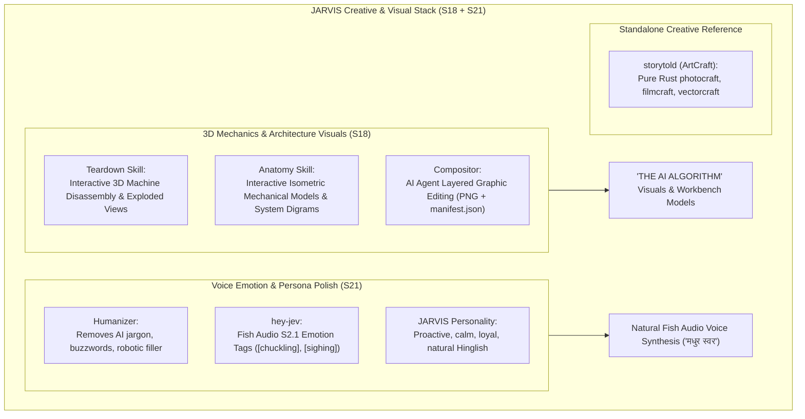

# JARVIS Research — 02_VISUAL.md
**Category**: Visual-3D, Creative Engineering, Voice Emotion & Text Polish (Items 64 to 69)  
**Target Squad**: S18 (AI Workbench), S21 (Persona & Voice), S10 (Insights & Visual Boards)  
**Lead Architect**: Senior Research + Architecture Agent  
**Status**: Batch 2 In-Depth Analysis Complete  

---

## 1. Architectural Synthesis: 3D Visualization, Voice Emotion & Natural Speech

---

## 2. In-Depth Item Notes (Items 64 to 69)

---

### 64. Teardown (elvarofficial/teardown)
- **Official Link**: [https://github.com/elvarofficial/teardown](https://github.com/elvarofficial/teardown)
- **Kya Hai**: Open-source coding agent skill jo mechanical systems aur machines ke descriptions ko interactive, offline 3D simulators aur exploded-view HTML pages mein convert kar deta hai (disassembly animation + procedural audio + 60fps video capture).
- **Problem Hal Karta Hai, Fayda & Kamiyan**:
  - *Problem*: Technical mechanisms (jaise engines, turbines, pumps, robotics) ko static text ya 2D diagrams se samjhana bohot mushkil hota hai.
  - *Fayda*: Single self-contained HTML output; users 3D mein parts ko alag-alag karke ghumakar dekh sakte hain; automated 60fps MP4 export.
  - *Kamiyan*: Complex multi-part mechanical 3D meshes generate karne mein token/compute intensive ho sakta hai.
- **Platform, License & Last Update**:
  - *Platform*: HTML5 / WebGL / Three.js, Claude Code / Antigravity skill.
  - *License*: MIT.
  - *Last Update*: Active.
- **Setup Complexity**: **Easy** (`npx skills add elvarofficial/teardown`).
- **Security & Risk Matrix**:
  - *Risk Level*: **Zero / Safe**. Generates offline static HTML and WebGL assets.
- **JARVIS Mein Fitment**:
  - *Mapped Squad*: **S18 (AI Workbench)** & YouTube Channel ("THE AI ALGORITHM").
  - *Feature*: High-retention technical teardown animations and video assets for YouTube tutorials.
- **JARVIS Mein Pehle Se Kya Hai vs Ye Behtar Kaise Hai**:
  - JARVIS ke paas video/creative visual skill nahi thi. Teardown enables JARVIS to produce viral 3D engineering explainer visuals on demand.
- **FAISLA**: **LO (Creative Skill Seedha Kaam Ka)**. Installed as a permanent skill in AI Workbench and media workflows.

---

### 65. Anatomy (wheresryan22/anatomy)
- **Official Link**: [https://github.com/wheresryan22/anatomy](https://github.com/wheresryan22/anatomy)
- **Kya Hai**: Coding agent skill jo abstract software architecture concepts, backend pipelines, aur algorithms ko **detailed, interactive isometric mechanical machines** (SVG, WebGL shaders, animated brass-and-glass mechanisms) mein translate karta hai.
- **Problem Hal Karta Hai, Fayda & Kamiyan**:
  - *Problem*: Boring box-and-arrow flowcharts architecture ko engaging tarike se convey nahi karte.
  - *Fayda*: Transforms intangible concepts (jaise rate limiters, token buckets, event buses, Raft consensus) into living, breathing mechanical machine diagrams with interactive sliders.
  - *Kamiyan*: Requires good visual styling prompt guidance.
- **Platform, License & Last Update**:
  - *Platform*: Skill standard (Claude Code, Antigravity).
  - *License*: MIT.
  - *Last Update*: Active.
- **Setup Complexity**: **Easy**.
- **Security & Risk Matrix**:
  - *Risk Level*: **Zero / Safe**.
- **JARVIS Mein Fitment**:
  - *Mapped Squad*: **S18 (Workbench)**, **S10 (Insights/Boards)**, YouTube Tutorials.
  - *Feature*: Visualizing JARVIS's internal architecture (S00–S22) and creating visual assets for THE AI ALGORITHM.
- **JARVIS Mein Pehle Se Kya Hai vs Ye Behtar Kaise Hai**:
  - JARVIS currently uses Mermaid diagrams. Anatomy provides AAA-tier interactive isometric machine visuals.
- **FAISLA**: **LO (Seedha Kaam Ka - Visual Architecture Skill)**.

---

### 66. Compositor (robbietilton/Compositor)
- **Official Link**: [https://github.com/robbietilton/Compositor](https://github.com/robbietilton/Compositor)
- **Kya Hai**: Open-source desktop layered image editor jo vishesh roop se isliye banaya gaya hai taaki AI coding agents local disk par transparent project folders (`.comp`) mein standard PNG assets aur plain-text `manifest.json` ko autonomously edit aur live-reload kar sakein.
- **Problem Hal Karta Hai, Fayda & Kamiyan**:
  - *Problem*: Photoshop, Figma ya proprietary image formats binary hote hain jinhe AI agents directly manipulate nahi kar sakte.
  - *Fayda*: Pure plain-text `manifest.json` (coordinates, layers, opacity, blend modes) + standard PNGs. Agent text edit karke layout badalta hai aur visual canvas instant update hota hai!
  - *Kamiyan*: macOS desktop app currently.
- **Platform, License & Last Update**:
  - *Platform*: macOS (Swift / Metal).
  - *License*: MIT.
  - *Last Update*: Active.
- **Security & Risk Matrix**:
  - *Risk Level*: **Safe**. Local disk file editing.
- **JARVIS Mein Fitment**:
  - *Mapped Squad*: **S18 (AI Workbench - Design Tool)** & Design-Clone SaaS.
  - *Feature*: Enabling JARVIS to design layered promotional graphics, thumbnails, and UI layouts on disk.
- **FAISLA**: **LO + SEEKHO (Agent-Native Graphic Editing Pattern)**. Manifest-based layered image architecture adopt karein.

---

### 67. storytold (storytold GitHub Org)
- **Official Link**: [https://github.com/storytold](https://github.com/storytold)
- **Kya Hai**: Pure-Rust open-source creative software suite (ArtCraft): `photocraft` (photo editor), `filmcraft` (NLE video editor), `lightcraft`, `pdfcraft`, `vectorcraft`, aur `gridcraft` (spreadsheet) built from scratch in pure Rust.
- **Problem Hal Karta Hai, Fayda & Kamiyan**:
  - *Problem*: Heavy Adobe/Electron creative suites high RAM consume karte hain.
  - *Fayda*: Blazing fast, zero garbage collection, pure Rust compiled binaries, clean-room implementations.
  - *Kamiyan*: Work in progress creative apps; not yet full replacements for Photoshop or Premiere.
- **Platform, License & Last Update**:
  - *Platform*: Rust, cross-platform.
  - *License*: Open Source (MIT/Apache).
  - *Last Update*: Active.
- **JARVIS Mein Fitment**:
  - *Mapped Squad*: Reference Library for local media toolchains.
- **FAISLA**: **REFERENCE (Baad Mein Kaam Aayega)**. Include in `research/REFERENCE_LIBRARY.md` under Rust creative tools.

---

### 68. Humanizer (blader/humanizer)
- **Official Link**: [https://github.com/blader/humanizer](https://github.com/blader/humanizer)
- **Kya Hai**: Open-source writing refinement utility aur prompt framework jo AI-generated text se robotic markers, clichés, hollow buzzwords ("delve", "tapestry", "revolutionize", "beacon"), aur formulaic structures ko strip karke text ko 100% human, crisp, aur authentic banata hai.
- **Problem Hal Karta Hai, Fayda & Kamiyan**:
  - *Problem*: AI responses boring, repetitive aur synthetic lagti hain.
  - *Fayda*: Instant tone elevation; natural conversational flow; strips robotic AI mannerisms.
  - *Kamiyan*: None. Pure stylistic guardrail.
- **Platform, License & Last Update**:
  - *Platform*: Python, TypeScript, prompt rules.
  - *License*: MIT.
  - *Last Update*: Active.
- **Security & Risk Matrix**:
  - *Risk Level*: **Zero / Safe**.
- **JARVIS Mein Fitment**:
  - *Mapped Squad*: **S21 (Persona - Identity & Phrasing)**.
  - *Feature*: Output sanitization pipeline for JARVIS voice replies and Amit's YouTube scripts!
- **JARVIS Mein Pehle Se Kya Hai vs Ye Behtar Kaise Hai**:
  - JARVIS S21 persona already Hindi/Hinglish rules enforce karta hai. Humanizer's English anti-AI vocabulary filter ensures ki English responses mein bhi zero robotic fluff ho.
- **FAISLA**: **LO (Persona Polish Filter - Seedha Kaam Ka)**. Integrated directly into S21 Persona system prompt and post-processing.

---

### 69. hey-jev (henryklunaris/hey-jev)
- **Official Link**: [https://github.com/henryklunaris/hey-jev](https://github.com/henryklunaris/hey-jev)
- **Kya Hai**: Python voice assistant jo local `faster-whisper` STT, low-cost command-vs-chat routing, aur **Fish Audio (S2.1 Pro) voice synthesis with emotion tags** (`[chuckling]`, `[sighing]`, `[gasping]`, `[whispering]`, `[laughing]`) integrate karta hai.
- **Problem Hal Karta Hai, Fayda & Kamiyan**:
  - *Problem*: AI voice assistants monotonous aur flat robotic sound karte hain.
  - *Fayda*: Directly leverages Fish Audio's native S2.1 phonetic emotion markdown tags to deliver expressive, natural speech with dry wit, sighs, and laughter!
  - *Kamiyan*: macOS focused wake-word script.
- **Platform, License & Last Update**:
  - *Platform*: Python, macOS/Linux, Fish Audio API.
  - *License*: MIT.
  - *Last Update*: Active.
- **JARVIS Mein Fitment**:
  - *Mapped Squad*: **S21 (Persona & Voice)** & **packages/voice**.
  - *Feature*: Adding emotion tags to JARVIS's official Fish Audio voice engine!
- **JARVIS Mein Pehle Se Kya Hai vs Ye Behtar Kaise Hai**:
  - JARVIS already uses Fish Audio model `41b1bce659f041e68abeac8612e190e1` with pronunciation maps (`packages/voice/src/pronunciation.ts`). Lekin JARVIS abhi emotion tags (`[chuckling]`, `[sighing]`) use nahi kar raha tha. `hey-jev` reveals exactly how to format text prompts sent to Fish Audio to trigger genuine emotional human-like delivery!
- **FAISLA**: **LO (Fish Audio Emotion Tags Seedha Kaam Ka)**. Add emotion tag injection into `packages/voice/src/toSpeech.ts` so JARVIS can chuckle, sigh, or sound serious when appropriate.

---

## 3. Batch 2 Visual & Creative Summary Table

| # | Item Name | Category | Primary Fitment | Recommendation |
|---|---|---|---|---|
| **64** | **Teardown** | Visual | S18, Content | **LO**: 33D exploded-view simulator generator for YouTube tutorials & workbench. |
| **65** | **Anatomy** | Visual | S18, S10 | **LO**: Isometric mechanical architecture illustration skill. |
| **66** | **Compositor** | Visual | S18, Design-Clone | **LO + SEEKHO**: Plain-text manifest-based layered image editing for agents. |
| **67** | **storytold** | Visual | Reference Library | **REFERENCE**: Pure Rust creative apps suite. |
| **68** | **Humanizer** | Visual/Persona | S21 (Persona) | **LO**: Anti-robotic fluff filter for natural speech and scripting. |
| **69** | **hey-jev** | Voice/Persona | S21, packages/voice | **LO**: Fish Audio S2.1 emotion tags (`[chuckling]`, `[sighing]`) injection for JARVIS. |
